# MNIST ile MLP Tabanlı El Yazısı Rakam Tanıma

Yapay Sinir Ağları dersi ödevi. MNIST veri seti üzerinde sıfırdan eğitilen bir Multi-Layer Perceptron (MLP) ile el yazısı rakam tanıma; farklı model yapılandırmalarının karşılaştırılması ve modelin kendi el yazımla yazdığım öğrenci numarası üzerindeki başarısının değerlendirilmesi.

> Bu dosya ödevin raporudur. Bölümler deneyler ilerledikçe doldurulmaktadır.

## Ödev Gereksinimleri ve Karşılandığı Yer

| Gereksinim | Durum | Nerede |
|---|---|---|
| Model MLP (CNN yok), hazır model yok, sıfırdan eğitim | ✅ | [Bölüm 4.1](#41-model) |
| En az 2 gizli katman, ReLU aktivasyonu | ✅ (Sigmoid ve Tanh ile karşılaştırıldı) | [Bölüm 4.1](#41-model), [Bölüm 5.4](#54-derinlik-ve-genişlik), [Bölüm 5.5](#55-aktivasyon-fonksiyonu) |
| Uygun sınıflandırma loss'u, SGD veya Adam | ✅ cross-entropy (MSE ve hinge ile karşılaştırıldı) + momentumlu SGD (düz SGD ve Adam ile karşılaştırıldı) | [Bölüm 4.2](#42-hiperparametreler), [Bölüm 5.2](#52-loss-fonksiyonu), [Bölüm 5.3](#53-optimizer-ve-learning-rate) |
| Train / validation / test ayrımı açıkça gösterilmiş | ✅ | [Bölüm 3](#3-veri-seti-ve-trainvalidationtest-ayrımı) |
| Test verisi model geliştirmede kullanılmamış | ✅ kodla garanti altında | [Bölüm 3](#3-veri-seti-ve-trainvalidationtest-ayrımı) |
| Deney 1: train/val loss, train/val accuracy, test accuracy, eğitim süresi | ✅ | [Bölüm 4.4](#44-sonuçlar) |
| Deney 1: loss ve accuracy grafikleri | ✅ | [Bölüm 4.4](#44-sonuçlar) |
| Model yapılandırmalarının karşılaştırılması | ✅ 8 tek değişkenli deney (5.1 normalizasyon, 5.2 loss, 5.3 optimizer ve learning rate, 5.4 derinlik ve genişlik, 5.5 aktivasyon, 5.6 batch boyutu, 5.7 regularization, 5.8 epoch sayısı ve early stopping) + 60 denemelik ortak arama ve en iyilerin yeni seed'lerle doğrulanması (Bölüm 6) | [Bölüm 5](#5-karşılaştırmalı-deneyler), [Bölüm 6](#6-ortak-hiperparametre-araması) |
| Kullanılan hiperparametreler raporda | ✅ Deney 1, Bölüm 5 ve 6 / ⏳ final model | [Bölüm 4.2](#42-hiperparametreler), Bölüm 5–7 |
| El yazısı görüntüleri: gri, 28×28, MNIST renk uyumu, normalizasyon | ⏳ | [Bölüm 8](#8-kendi-el-yazım-ile-değerlendirme) |
| El yazısıyla öğrenci numarası görselleri repoda | ⏳ | [`el_yazisi/`](el_yazisi/) |
| Deney sonuçları hakkında genel değerlendirme | ⏳ | [Bölüm 9](#9-genel-değerlendirme) |
| Kodun çalıştırılabilir olması | ✅ kurulum, veri, Deney 1, Bölüm 5 ve 6 / ⏳ diğer aşamalar | [Bölüm 1](#1-ortam-ve-kurulum) |

## İçindekiler
1. [Ortam ve Kurulum](#1-ortam-ve-kurulum)
2. [Proje Yapısı](#2-proje-yapısı)
3. [Veri Seti ve Train/Validation/Test Ayrımı](#3-veri-seti-ve-trainvalidationtest-ayrımı)
4. [Deney 1 – Temel MLP Modeli](#4-deney-1--temel-mlp-modeli)
5. [Karşılaştırmalı Deneyler](#5-karşılaştırmalı-deneyler)
6. [Ortak Hiperparametre Araması](#6-ortak-hiperparametre-araması)
7. [Final Model ve Test Sonucu](#7-final-model-ve-test-sonucu)
8. [Kendi El Yazım ile Değerlendirme](#8-kendi-el-yazım-ile-değerlendirme)
9. [Genel Değerlendirme](#9-genel-değerlendirme)

## 1. Ortam ve Kurulum

| | |
|---|---|
| İşletim sistemi | Windows 11 |
| CPU | AMD Ryzen 7 9800X3D |
| GPU | AMD Radeon RX 9070 XT (ROCm) |
| Python | 3.12 |
| Kütüphane | PyTorch (ROCm sürümü) |

Kurulum:

```bash
python -m venv .venv
.venv\Scripts\activate

# Yalnızca AMD GPU (RX 9070 serisi) için: önce ROCm'lu PyTorch kurulur
python -m pip install --index-url https://stable.repo.amd.com/rocm/whl-next/ "torch[device-gfx1201]==2.14.0+rocm10.1.0" "torchvision[device-gfx1201]==0.29.0a0+rocm10.1.0"

# Diğer bağımlılıklar (CPU veya NVIDIA kullananlar doğrudan bu adımla başlayabilir)
python -m pip install -r requirements.txt

# Ortam kontrolü
python src/check_device.py
```

Kod GPU bulamazsa otomatik olarak CPU'da çalışır.

Deneyleri çalıştırma (komutlar bu klasörde çalıştırılır; sonuçlar `results/` altına yazılır):

| Komut | Ne yapar | Süre (RX 9070 XT) |
|---|---|---|
| `python src/explore_data.py` | Veri ayrımı, sınıf dağılımı ve örnek görsel grafikleri (Bölüm 3) | birkaç saniye |
| `python src/deney1.py` | Deney 1: baseline MLP, 3 seed × 20 epoch, test değerlendirmesi (Bölüm 4) | ~1 dakika |
| `python src/karsilastirma.py 4a1_normalizasyon` | Normalizasyon karşılaştırması, Adam (Bölüm 5.1) | ~2.5 dakika |
| `python src/karsilastirma.py 4a1b_normalizasyon_sgd` | Normalizasyon karşılaştırması, ek analiz: SGD (Bölüm 5.1) | ~2.5 dakika |
| `python src/karsilastirma.py 4a2_loss` | Loss fonksiyonu karşılaştırması, Adam (Bölüm 5.2) | ~3 dakika |
| `python src/karsilastirma.py 4a2b_loss_sgd` | Loss fonksiyonu karşılaştırması, ek analiz: SGD (Bölüm 5.2) | ~2.5 dakika |
| `python src/karsilastirma.py 4a3_optimizer_lr` | Optimizer ve learning rate karşılaştırması: 3 optimizer × 4–5 learning rate (Bölüm 5.3) | ~12 dakika |
| `python src/karsilastirma.py 4a4_derinlik_genislik` | Derinlik ve genişlik: 1–4 gizli katman × 64–1024 nöron (Bölüm 5.4) | ~20 dakika |
| `python src/karsilastirma.py 4a5_aktivasyon` | Aktivasyon: ReLU / Sigmoid / Tanh, her biri 4–5 learning rate ile (Bölüm 5.5) | ~11 dakika |
| `python src/karsilastirma.py 4a6_batch` | Batch boyutu: 16–2048, iki learning rate kuralıyla (Bölüm 5.6) | ~15 dakika |
| `python src/karsilastirma.py 4a7_regularization` | Regularization: dropout / weight decay / batch normalization / veri artırma, farklı güçlerde (Bölüm 5.7) | ~1.5 dakika |
| `python src/karsilastirma.py 4a8_epoch` | Epoch sayısı, early stopping ve seçim ölçütü: 100 epoch × 3 seed, 10 kural (Bölüm 5.8) | ~1 dakika |
| `python src/arama.py ara` | Ortak arama: rastgele arama ve TPE, 30'ar deneme (Bölüm 6.2) | ~22 dakika |
| `python src/arama.py dogrula` | En iyi 5 ayar + 4A'nın sonucu, 3 yeni seed'le; final ayarı seçer (Bölüm 6.3) | ~13 dakika |

## 2. Proje Yapısı

```
├── README.md            ← rapor
├── requirements.txt
├── src/                 ← kaynak kodlar
├── el_yazisi/
│   ├── ham/             ← el yazısıyla öğrenci numarası fotoğrafları (ham hâli)
│   └── islenmis/        ← MNIST formatına getirilmiş 28×28 hâli
└── results/             ← deney sonuçları ve grafikler
```

## 3. Veri Seti ve Train/Validation/Test Ayrımı

Kod: [`src/data.py`](src/data.py), analiz: [`src/explore_data.py`](src/explore_data.py)

MNIST; 28×28 piksel, gri seviyeli (0 = siyah zemin, 255 = beyaz mürekkep), 10 sınıflı el yazısı rakam görüntülerinden oluşur.

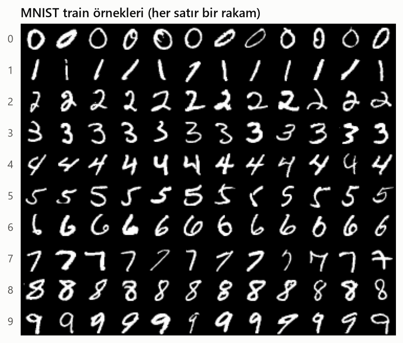

### Ayrım

| Parça | Kaynak | Boyut | Kullanım amacı |
|---|---|---|---|
| Train | MNIST eğitim kısmı | 50.000 | Ağırlıkların öğrenilmesi |
| Validation | MNIST eğitim kısmı | 10.000 | Hiperparametre ve model seçimi, overfitting takibi |
| Test | MNIST test kısmı | 10.000 | Yalnızca en sonda, bir kez: nihai performans |

- **Neden 50.000 / 10.000?** Validation seti test setiyle aynı boyutta olduğu için doğruluk tahmini aynı hassasiyette (bir örnek = %0,01) olur. Daha küçük bir validation seti (ör. 6.000) train'e 4.000 örnek kazandırırdı, ancak model seçiminde ölçüm gürültüsü artardı.
- **Neden rastgele ayrım (stratified değil)?** 10.000 örneklik rastgele bir parçada sınıf oranları zaten dengeli kalır (aşağıdaki grafik). Stratified ayrım oranları birebir eşitlerdi ama bu veri boyutunda pratik bir fark yaratmaz.
- **Tekrarlanabilirlik:** Karıştırma sabit bir seed (`42`) ile yapılır; her çalıştırmada aynı 10.000 görüntü validation'a düşer.
- **Test setinin korunması:** `load_data()` test setini varsayılan olarak döndürmez (`include_test=False`). Test verisi yalnızca açıkça istendiğinde yüklenir; böylece model geliştirme sırasında yanlışlıkla kullanılamaz.

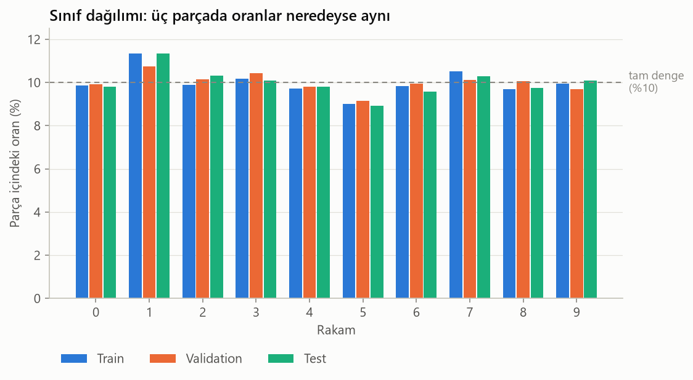

| Rakam | Train | Validation | Test |
|---|---|---|---|
| 0 | 4930 (%9.9) | 993 (%9.9) | 980 (%9.8) |
| 1 | 5668 (%11.3) | 1074 (%10.7) | 1135 (%11.4) |
| 2 | 4942 (%9.9) | 1016 (%10.2) | 1032 (%10.3) |
| 3 | 5089 (%10.2) | 1042 (%10.4) | 1010 (%10.1) |
| 4 | 4860 (%9.7) | 982 (%9.8) | 982 (%9.8) |
| 5 | 4507 (%9.0) | 914 (%9.1) | 892 (%8.9) |
| 6 | 4923 (%9.8) | 995 (%9.9) | 958 (%9.6) |
| 7 | 5254 (%10.5) | 1011 (%10.1) | 1028 (%10.3) |
| 8 | 4846 (%9.7) | 1005 (%10.1) | 974 (%9.7) |
| 9 | 4981 (%10.0) | 968 (%9.7) | 1009 (%10.1) |

Sınıflar arasında en büyük fark 1 (%11,3) ile 5 (%9,0) arasındadır. Bu dengesizlik küçük olduğu için sınıf ağırlıklandırması gibi ek bir önleme gerek görülmemiştir; accuracy anlamlı bir metrik olarak kullanılabilir.

### Normalizasyon istatistikleri

Her görüntü 784 uzunluğunda bir vektöre düzleştirilir (MLP girdisi). Standardizasyon `(x − ortalama) / std` ile yapılır ve **ortalama ile std yalnızca train parçasından hesaplanır**:

| Hesaplandığı veri | Ortalama | Std |
|---|---|---|
| Yalnızca train (kullanılan) | 0,1306 | 0,3081 |
| Train + validation + test | 0,1309 | 0,3084 |

Validation ve test verisi istatistik hesabına katılsaydı, model değerlendirme verisi hakkında önceden bilgi almış olurdu (**veri sızıntısı**). MNIST'te iki değer arasındaki fark çok küçüktür. Yine de doğru yöntem, gerçek hayattaki durumu taklit etmektir: model eğitilirken gelecekteki verinin istatistiği bilinmez. Aynı train istatistikleri kendi el yazısı görüntülerimize de uygulanacaktır.

Ortalamanın düşük (0,13) olmasının nedeni piksellerin **%80,9'unun tamamen siyah** olmasıdır; rakam görüntünün yalnızca küçük bir bölümünü kaplar.

Alternatif normalizasyon yöntemleri (ham [0–255], [0–1] ölçekleme) Bölüm 5'te karşılaştırılacaktır.

## 4. Deney 1 – Temel MLP Modeli

Kod: [`src/deney1.py`](src/deney1.py), [`src/model.py`](src/model.py), [`src/train.py`](src/train.py) · Çalıştırma: `python src/deney1.py` (GPU'da ~1 dakika) · Ham sonuçlar: [`results/deney1/sonuclar.json`](results/deney1/sonuclar.json)

### 4.1 Model

```
girdi: 784 piksel (28×28 görüntü düzleştirilmiş, standardize edilmiş)
  ├─ Linear 784 → 256  +  ReLU     1. gizli katman
  ├─ Linear 256 → 128  +  ReLU     2. gizli katman
  └─ Linear 128 → 10               çıktı: her rakam için bir skor (logit)
```

- Yalnızca tam bağlantılı (`nn.Linear`) katmanlardan oluşan bir MLP. CNN katmanı yok.
- Toplam **235.146** parametre; bunların %85'i ilk katmanda.
- Model **sıfırdan** eğitildi. Ağırlıklar PyTorch'un varsayılan rastgele başlangıç değerleriyle başlıyor; hazır veya önceden eğitilmiş ağırlık kullanılmadı.
- Softmax modelin içinde değil, loss fonksiyonunun (`nn.CrossEntropyLoss`) içinde uygulanıyor.

### 4.2 Hiperparametreler

| Hiperparametre | Değer | Not |
|---|---|---|
| Gizli katmanlar | 2 katman: 256 → 128 nöron | Ödev şartı: en az 2 gizli katman |
| Aktivasyon | ReLU | Ödev şartı |
| Loss | Cross-entropy | Sınıflandırma için standart loss |
| Optimizer | Adam | Ödev şartı: SGD veya Adam |
| Learning rate | 0.001 | Adam'ın önerilen varsayılan değeri (Kingma & Ba, 2015) |
| Batch boyutu | 64 | Epoch başına 782 adım |
| Epoch sayısı | 20 | Early stopping yok |
| Regularization | Yok | Dropout 0, weight decay 0, batch normalization yok |
| Girdi normalizasyonu | Standardizasyon | Train istatistikleriyle: ortalama 0.1306, std 0.3081 (Bölüm 3) |
| Başlangıç ağırlıkları | PyTorch varsayılanı (`nn.Linear`) | |
| Model seçimi | En düşük validation loss'lu epoch | Eğitim sonunda o epoch'un ağırlıkları geri yüklenir |
| Tekrar | 3 seed (0, 1, 2) | Sonuçlar ortalama ± standart sapma olarak verilir |

Bu değerler bilinçli olarak sade ve yaygın başlangıç değerleri olarak seçildi. Her birinin alternatifleri Bölüm 5'te deneyle karşılaştırılacak.

### 4.3 Ölçüm yöntemi

- **Train ve validation metrikleri:** Her epoch sonunda, train ve validation setlerinin **tamamında**, model eval modundayken ölçüldü. Epoch boyunca batch'lerin ortalaması kullanılmadı; o yöntem, epoch boyunca değişen bir modeli ölçtüğü için validation ile adil kıyaslanmaz.
- **Raporlanan model:** Her seed için validation loss'un en düşük olduğu epoch'un ağırlıkları. Tablodaki train, validation ve test değerleri bu modele aittir.
- **Test seti:** Yalnızca bu tabloyu raporlamak için bir kez kullanıldı. Hiçbir hiperparametre kararı test sonucuna bakılarak verilmedi.
- **Eğitim süresi:**
  - Yalnızca optimizasyon adımlarını kapsar; epoch sonu ölçümler dahil değildir.
  - GPU asenkron çalıştığı için süre `torch.cuda.synchronize()` ile ölçüldü.
  - İlk GPU çağrısındaki tek seferlik kütüphane yükleme maliyeti, ölçümden önce yapılan bir ısınma turuyla ölçüm dışında bırakıldı.
- **Tekrarlanabilirlik:** Seed'ler sabit. Ancak kullanılan ROCm GPU'da aynı seed bile program yeniden başlatıldığında son basamaklarda farklı sonuç verebiliyor. Kod tekrar çalıştırıldığında sayılar küçük farklarla değişebilir; bu yüzden sonuçlar 3 seed'in ortalaması ± standart sapması olarak verildi.

### 4.4 Sonuçlar

Donanım: AMD Radeon RX 9070 XT (ROCm), PyTorch 2.14.0+rocm10.1.0, Python 3.12

| Seed | En iyi epoch | Train loss | Val loss | Train acc | Val acc | Test loss | Test acc | Eğitim süresi (20 epoch) |
|---|---|---|---|---|---|---|---|---|
| 0 | 9 | 0.0136 | 0.0847 | %99.57 | %97.94 | 0.0895 | %97.82 | 16.3 sn |
| 1 | 4 | 0.0314 | 0.0765 | %99.09 | %97.59 | 0.0747 | %97.76 | 16.6 sn |
| 2 | 7 | 0.0150 | 0.0747 | %99.56 | %97.96 | 0.0749 | %97.92 | 16.5 sn |
| **Ortalama ± std** | 6.7 ± 2.5 | 0.0200 ± 0.0099 | 0.0786 ± 0.0053 | %99.41 ± 0.27 | %97.83 ± 0.21 | 0.0797 ± 0.0084 | %97.83 ± 0.08 | 16.5 ± 0.1 sn |

**Özetle:** Training loss **0.020**, validation loss **0.079**, training accuracy **%99.41**, validation accuracy **%97.83**, test accuracy **%97.83**. Eğitim süresi 20 epoch için **16.5 sn** (epoch başına ~0.82 sn).

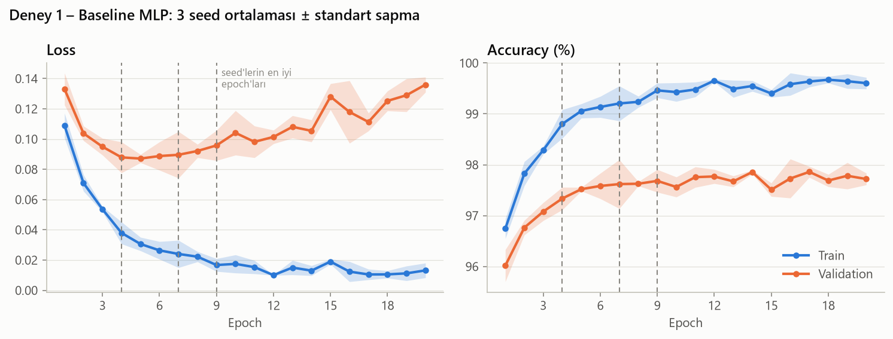

*Çizgiler 3 seed'in ortalaması, gölgeler ± standart sapma. Kesikli dikey çizgiler her seed'in en düşük validation loss'lu epoch'u.*

### 4.5 Değerlendirme

1. **Validation, testi iyi temsil ediyor.** Test doğruluğu (%97.83 ± 0.08) validation doğruluğuyla (%97.83 ± 0.21) aynı. Bu yüzden sonraki deneylerde kararları validation'a bakarak vermek güvenilir.
2. **Overfitting var.**
   - Ortalama validation loss en düşük değerine 5. epoch'ta ulaşıyor (0.087) ve 20. epoch'ta 0.136'ya çıkıyor (%56 artış).
   - Aynı sürede training loss 0.109'dan 0.013'e düşüyor.
   - 20. epoch'ta training accuracy %99.60, validation accuracy %97.72.

   Model belli bir noktadan sonra genel kalıpları öğrenmek yerine train setine özgü ayrıntıları ezberliyor. Baseline'da hiçbir regularization olmadığı için bu beklenen bir sonuç.
3. **Validation loss artarken validation accuracy düşmüyor.** Validation accuracy 5. epoch'ta %97.52, 20. epoch'ta %97.72. Cross-entropy, modelin yanlış tahminlerine ne kadar emin olduğunu da cezalandırır. Eğitim ilerledikçe model aşırı özgüvenli hâle geliyor: yanlış bildiği görüntü sayısı pek değişmiyor, ama bu yanlışlarda giderek daha emin oluyor. Accuracy bunu görmüyor, loss görüyor.
4. **En iyi epoch seed'e göre 4 ile 9 arasında değişiyor**, çünkü ortalama validation loss bu aralıkta oldukça düz seyrediyor. Model seçme ölçütü (validation loss mu, validation accuracy mi) ve early stopping Bölüm 5'te incelenecek.
5. **Seed'ler arası değişkenlik küçük.** Accuracy'deki standart sapma 0.1–0.3 puan. Sonraki karşılaştırmalarda bu büyüklükteki farklar anlamlı kabul edilmeyecek.
6. **Eğitim süresi.** 20 epoch GPU'da 16.5 sn sürdü. Validation loss 5. epoch civarında en düşük seviyeye indiği için 20 epoch'un büyük kısmı genellemeye katkı sağlamadı. Early stopping hem overfitting'i hem eğitim süresini azaltabilir (Bölüm 5).

## 5. Karşılaştırmalı Deneyler

Kod: [`src/karsilastirma.py`](src/karsilastirma.py) · Çalıştırma: `python src/karsilastirma.py <deney_adı>` · Ham sonuçlar: [`results/karsilastirma/`](results/karsilastirma/)

### 5.0 Yöntem

Deney 1'deki baseline'ın ayarları **tek tek** değiştirilerek karşılaştırıldı. Kurallar sonuçlar görülmeden önce belirlendi:

1. Her deneyde yalnızca **bir** hiperparametre değişir; geri kalan her şey sabit kalır.
2. Her seçenek 3 seed (0, 1, 2) ile 20 epoch eğitilir.
3. **Test seti kullanılmaz;** bu deneylerde yüklenmez bile. Bütün kararlar validation setine göre verilir.
4. **Birincil ölçüt:** en düşük validation loss'lu epoch'taki validation accuracy'nin 3 seed ortalaması. Bu, Deney 1'deki model seçimiyle aynı.
5. **Anlamlılık eşiği: 0.3 puan.** Deney 1'de aynı ayarlarla bile seed'ler arasındaki standart sapma ~0.2 puan çıktı. 3 seed'in ortalaması bu gürültüyü azaltır ama yok etmez; bu yüzden iki ortalama arasındaki 0.3 puandan küçük farklar anlamlı kabul edilmez.
6. Fark anlamlı değilse **ikincil ölçütlere** bakılır: yakınsama hızı (1. epoch validation accuracy), validation loss, eğitim süresi, sadelik ve sağlamlık. Bunlar da ayırt etmiyorsa mevcut ayarda kalınır.
7. Kazanan seçenek, bir sonraki deneyin başlangıç ayarına eklenir.

**Yöntemin sınırı:** Ayarları tek tek değiştirmek, ayarlar arasındaki etkileşimleri gözden kaçırabilir. Örneğin en iyi learning rate, batch boyutuna bağlı olabilir. Bu sınırlama Bölüm 6'da bütün ayarlar birlikte aranarak kontrol edilecek.

| # | Deney | Seçenekler | Karar |
|---|---|---|---|
| 5.1 | Girdi normalizasyonu | ham / min-max / standardizasyon | **Standardizasyon** |
| 5.2 | Loss fonksiyonu | cross-entropy / MSE / hinge | **Cross-entropy** |
| 5.3 | Optimizer ve learning rate | SGD / momentumlu SGD / Adam, her biri 4–5 learning rate ile | **Momentumlu SGD, lr = 0.01** |
| 5.4 | Derinlik ve genişlik | 1–4 gizli katman × 64–1024 nöron | **2 gizli katman × 256 nöron** |
| 5.5 | Aktivasyon | ReLU / Sigmoid / Tanh, her biri 4–5 learning rate ile | **ReLU** (ödev şartı), lr = 0.01 |
| 5.6 | Batch boyutu | 16 … 2048, learning rate sabit ya da batch ile orantılı | **Batch 512, lr = 0.08** |
| 5.7 | Regularization | dropout / weight decay / batch normalization / veri artırma, farklı güçlerde | **Veri artırma, hafif güçte** |
| 5.8 | Epoch sayısı, early stopping ve model seçme ölçütü | 10–100 epoch / early stopping (patience 5, 10); seçim val loss ya da val acc ile | **Early stopping: val loss, patience 5, en fazla 100 epoch** |

### 5.1 Girdi normalizasyonu

**Soru:** Piksel değerleri modele hangi ölçekte verilmeli?

| Seçenek | Dönüşüm | Değer aralığı |
|---|---|---|
| Ham piksel | `x` | 0 … 255 |
| Min-max | `x / 255` | 0 … 1 |
| Standardizasyon | `(x / 255 − 0.1306) / 0.3081` | −0.42 … 2.82 (ortalama 0, std 1) |

**Hipotezler:**
- **(a) Ölçek:** Büyük girdi değerleri büyük aktivasyonlara ve gradyanlara yol açar ve eğitimi kararsızlaştırır.
- **(b) Merkezleme:** Ortalaması 0 olan girdilerde, aynı nörona bağlı ağırlıklar aynı adımda farklı yönlere güncellenebilir; bu da yakınsamayı hızlandırır.
- Adam her ağırlığın adım büyüklüğünü kendisi ayarladığı için ölçek sorununu kısmen telafi edebilir.

**Sonuçlar (karar deneyi, Adam):**

| Seçenek | Val acc | Val loss (en düşük) | 1. epoch val acc | Train acc | En iyi epoch | Eğitim süresi (20 epoch) |
|---|---|---|---|---|---|---|
| Ham piksel (0–255) | %96.90 ± 0.30 | 0.1255 ± 0.0052 | %94.30 ± 0.76 | %98.43 ± 0.31 | 6.3 ± 2.1 | 16.6 ± 0.2 sn |
| Min-max (0–1) | %97.94 ± 0.19 | 0.0789 ± 0.0047 | %95.19 ± 0.44 | %99.51 ± 0.16 | 7.7 ± 1.2 | 16.6 ± 0.0 sn |
| Standardizasyon | %97.75 ± 0.19 | 0.0792 ± 0.0032 | %95.93 ± 0.30 | %99.26 ± 0.22 | 6.0 ± 1.7 | 16.4 ± 0.1 sn |

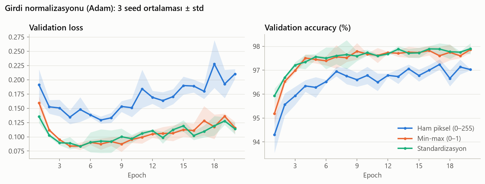

**Ek analiz (karar için değil):** Bölüm 5.3'te optimizer da değiştirileceği için, normalizasyon seçiminin optimizer'a göre değişip değişmediği düz SGD (lr = 0.1) ile kontrol edildi.

| Seçenek | Val acc | Val loss (en düşük) | 1. epoch val acc | Train acc | En iyi epoch | Eğitim süresi (20 epoch) |
|---|---|---|---|---|---|---|
| Ham piksel (0–255) | öğrenemedi (hep aynı tahmin, val acc %10.74) | – | – | – | – | – |
| Min-max (0–1) | %97.90 ± 0.13 | 0.0725 ± 0.0017 | %90.74 ± 1.44 | %99.69 ± 0.14 | 12.3 ± 1.5 | 14.4 ± 0.0 sn |
| Standardizasyon | %98.13 ± 0.09 | 0.0719 ± 0.0027 | %93.32 ± 2.21 | %99.93 ± 0.05 | 10.0 ± 1.0 | 14.6 ± 0.1 sn |

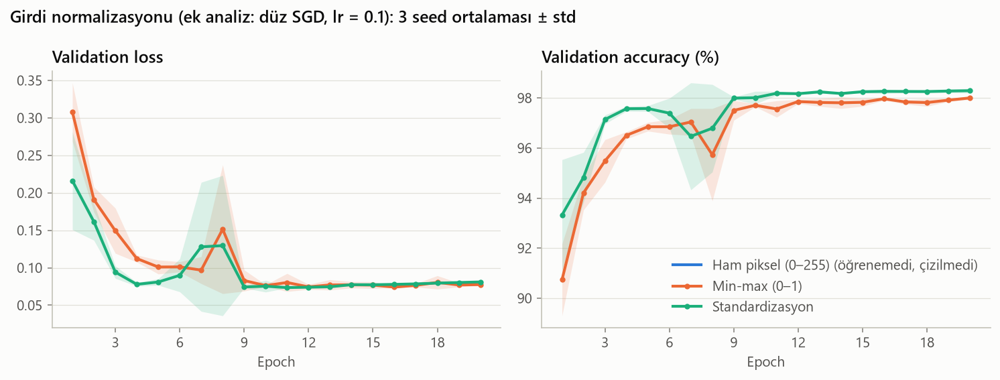

**Ham piksel + SGD neden hiç öğrenemedi?** Bu modelin içine bakıldığında:
- 1. gizli katmandaki nöronların **%99.6'sı**, 2. gizli katmandakilerin **%100'ü** hiçbir validation görüntüsünde aktif olmuyor (ReLU çıkışı hep 0).
- Model 10.000 validation görüntüsünün hepsine "1" diyor. %10.74, validation setindeki "1" rakamlarının oranı.

0–255 aralığındaki girdilerle ilk adımlardaki gradyanlar çok büyük çıkıyor ve lr = 0.1 ile atılan adımlar neredeyse bütün ReLU nöronlarını kalıcı olarak kapatıyor. Kapalı bir ReLU nöronundan gradyan geçmediği için ağ bir daha toparlanamıyor. Loss NaN olmuyor, rastgele tahmin seviyesinde (ln 10 ≈ 2.30) kalıyor.

**Karar:**
1. **Ham piksel elendi.** Adam ile ~1 puan kötü (anlamlı), SGD ile hiç öğrenemiyor. Hipotez (a) doğrulandı.
2. **Min-max ile standardizasyon doğrulukta ayırt edilemedi.**
   - Adam'da min-max 0.19 puan, SGD'de ise standardizasyon 0.23 puan önde. İkisi de 0.3 puanlık eşiğin altında.
   - Sıralamanın optimizer'a göre değişmesi de farkın gürültüden ibaret olduğunu destekliyor.
3. **İkincil ölçüt (yakınsama hızı) standardizasyonu gösteriyor.** Standardizasyon 1. epoch'ta her iki optimizer'da da önde: Adam'da +0.7 puan, SGD'de +2.6 puan. Bu, hipotez (b) ile uyumlu. Validation loss ve eğitim süresi iki seçenekte eşit.
4. **Seçilen: standardizasyon** (baseline'daki ayar korunuyor).
   - Min-max seçilmedi: doğrulukta ayırt edilemedi ama daha yavaş yakınsıyor.
   - Ham piksel seçilmedi: Adam'da kötü, SGD'de hiç öğrenemiyor.

**Sonraki deneyler için gözlem:** Düz SGD + standardizasyon, Adam + standardizasyondan daha yüksek validation accuracy'ye (%98.13'e karşı %97.75) ve daha düşük validation loss'a (0.072'ye karşı 0.079) ulaştı. SGD'nin validation loss'u Adam'daki gibi yükselmedi. Optimizer kararı Bölüm 5.3'te bu ipucu dikkate alınarak verilecek.

### 5.2 Loss fonksiyonu

**Soru:** Model hangi loss fonksiyonuyla eğitilmeli?

Model her görüntü için 10 skor (logit) `z` üretir. `p = softmax(z)` bu skorların olasılığa çevrilmiş hâlidir, `y` ise doğru sınıfın one-hot gösterimidir.

| Seçenek | Formül | PyTorch |
|---|---|---|
| Cross-entropy | `−log p_doğru` | `nn.CrossEntropyLoss` |
| MSE (softmax + one-hot) | `(1/10) · Σ (p_k − y_k)²` | `softmax` + `F.mse_loss` |
| Hinge (multi-margin) | `(1/10) · Σ max(0, 1 − z_doğru + z_k)`, doğru sınıf hariç bütün `k`'ler için | `nn.MultiMarginLoss` |

- **Cross-entropy:** Doğru sınıfa verilen olasılık düştükçe ceza logaritmik olarak büyür.
- **MSE:** Regresyonda kullanılan kare hatayı olasılıklarla one-hot hedef arasına uygular.
- **Hinge:** SVM'deki loss'un çok sınıflı hâlidir. Olasılık kullanmaz. Doğru sınıfın skoru diğer her sınıfın skorundan en az 1 fazlaysa ceza sıfırdır.

**Hipotezler:**
- **(a) Gradyan büyüklüğü:** İyi bir sınıflandırma loss'u, model yanlışken büyük, doğruyken küçük gradyan üretmelidir.
  - Cross-entropy'de logaritma ile softmax'in türevi birbirini götürür; logit'lere göre gradyan yalnızca `p − y` olur.
  - MSE'de softmax'in türevi gradyanı çarpan olarak küçültür. Model emin bir şekilde yanlış olduğunda bu çarpan sıfıra yaklaşır.
- **(b) Optimizer etkisi:** Adam her ağırlığın adımını o ağırlığın gradyan büyüklüğüne bölerek ölçekler. Bu yüzden küçük gradyanları büyük ölçüde telafi edebilir. Loss'lar arasındaki fark Adam'da küçük, düz SGD'de büyük çıkabilir.

Hipotez (a), tek bir örnek üzerinde kontrol edildi:

| Durum | p(doğru) | Cross-entropy | MSE | Hinge |
|---|---|---|---|---|
| Emin ve yanlış | 0.01 | 4.605 / **1.345** | 0.181 / **0.0176** | 1.351 / **0.949** |
| Kararsız | 0.10 | 2.303 / 0.949 | 0.090 / 0.0190 | 0.900 / 0.949 |
| Emin ve doğru | 0.99 | 0.010 / 0.0105 | 0.000 / 0.0000 | 0.000 / 0.000 |

*Hücreler: loss / gradyan büyüklüğü (loss'un 10 logit'e göre gradyanının normu). 10 sınıflı tek bir örnek kullanıldı; logit'ler doğru sınıfın olasılığı 0.01, 0.10 ve 0.99 olacak şekilde seçildi. Gradyanlar PyTorch autograd ile hesaplandı.*

- **Cross-entropy:** Model ne kadar yanlışsa gradyan o kadar büyük (1.345 > 0.949 > 0.0105).
- **MSE:**
  - Gradyan, cross-entropy'ninkinden 50–76 kat küçük.
  - Emin ve yanlış durumda gradyan, kararsız durumdakinden bile küçük (0.0176 < 0.0190). Model en çok düzeltilmesi gereken yerde en zayıf sinyali alıyor.
- **Hinge:** Gradyan, marj sağlanmadığı sürece sabit (0.949). Modelin ne kadar yanlış olduğunu ayırt etmiyor. Marj sağlandığında gradyan tamamen sıfır oluyor.

**Sonuçlar (karar deneyi, Adam):**

| Seçenek | Val acc | Val loss (her biri kendi loss'u, kıyaslanamaz) | 1. epoch val acc | Train acc | En iyi epoch | Eğitim süresi (20 epoch) |
|---|---|---|---|---|---|---|
| Cross-entropy | %97.68 ± 0.10 | 0.0782 ± 0.0027 | %95.93 ± 0.30 | %99.21 ± 0.24 | 5.7 ± 2.1 | 17.6 ± 0.2 sn |
| MSE (softmax + one-hot) | %97.89 ± 0.08 | 0.0034 ± 0.0001 | %95.37 ± 0.35 | %99.17 ± 0.22 | 11.3 ± 3.2 | 18.2 ± 0.2 sn |
| Hinge (multi-margin) | %97.45 ± 0.12 | 0.0098 ± 0.0004 | %95.07 ± 0.63 | %98.84 ± 0.32 | 5.3 ± 1.5 | 16.7 ± 0.2 sn |

Her seçeneğin loss'u farklı bir ölçekte olduğu için validation loss değerleri birbiriyle kıyaslanamaz. Bu yüzden grafikte loss yerine train ve validation accuracy çizildi.

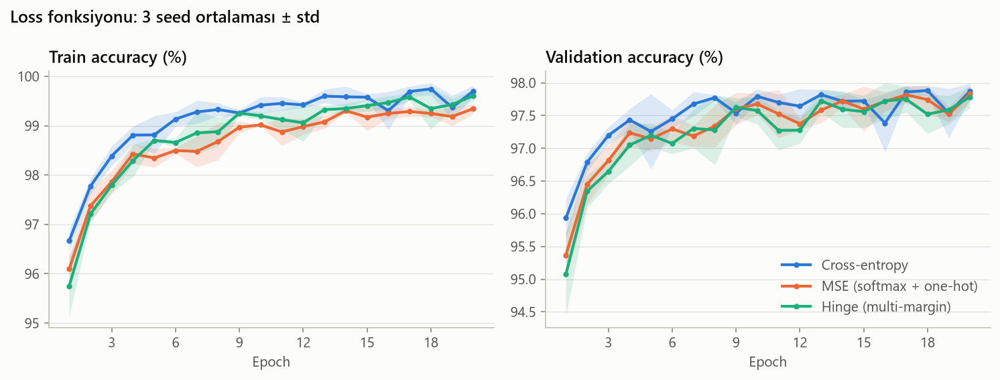

- **Hinge** en iyi seçenekten 0.45 puan geride. Fark eşiğin üzerinde, yani anlamlı.
- **MSE** sayıca en yüksek sonucu verdi. Ancak cross-entropy ile arasındaki 0.21 puanlık fark eşiğin altında.
- **Cross-entropy** ilk epoch'larda önde: 1. epoch'ta MSE'den 0.56, hinge'den 0.86 puan daha yüksek. Grafikte ~8. epoch'tan sonra eğriler birleşiyor.
- **MSE'nin en iyi epoch'u daha geç** (11.3'e karşı 5.7). MSE ile eğitilen model daha yavaş öğreniyor; train accuracy eğrisi de en altta kalıyor.

**Ek analiz (karar için değil):** Hipotez (b)'yi sınamak ve Bölüm 5.3'te optimizer değişeceği için aynı karşılaştırma düz SGD (lr = 0.1) ile tekrarlandı.

| Seçenek | Val acc | Val loss (her biri kendi loss'u, kıyaslanamaz) | 1. epoch val acc | Train acc | En iyi epoch | Eğitim süresi (20 epoch) |
|---|---|---|---|---|---|---|
| Cross-entropy | %98.03 ± 0.08 | 0.0713 ± 0.0024 | %93.67 ± 1.54 | %99.90 ± 0.03 | 9.3 ± 0.6 | 15.0 ± 0.1 sn |
| MSE (softmax + one-hot) | %95.62 ± 0.03 | 0.0068 ± 0.0001 | %75.03 ± 2.38 | %96.71 ± 0.05 | 20.0 ± 0.0 | 15.9 ± 0.2 sn |
| Hinge (multi-margin) | %97.86 ± 0.08 | 0.0088 ± 0.0003 | %92.96 ± 0.12 | %99.65 ± 0.01 | 20.0 ± 0.0 | 14.3 ± 0.1 sn |

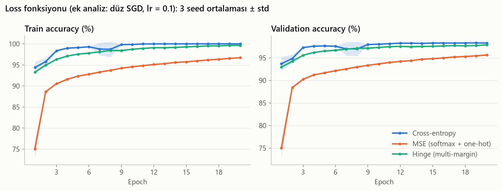

- **MSE düz SGD ile çok yavaş öğreniyor.**
  - 1. epoch'ta validation accuracy %75; cross-entropy'de %94.
  - 20 epoch sonunda %95.62 ile cross-entropy'nin 2.41 puan gerisinde kalıyor.
  - Üç seed'in de en iyi epoch'u 20. epoch. Yani model eğitim bittiğinde hâlâ gelişiyordu.

  Hipotez (a) ve (b) birlikte doğrulandı: MSE'nin gradyanı küçük ve Adam bunu telafi ediyordu. Düz SGD'de adım büyüklüğü doğrudan `lr × gradyan` olduğu için küçük gradyan, küçük adım demek.
- **Hinge düz SGD ile cross-entropy'ye yetişiyor** (0.16 puan geride, anlamsız) ve 20. epoch'ta hâlâ gelişiyor. Hinge'in Adam ile neden geride kaldığı bu deneyle belirlenemedi.

**Karar:**
1. **Hinge elendi.** Karar deneyinde (Adam) cross-entropy ve MSE'den anlamlı şekilde kötü.
2. **Cross-entropy ile MSE doğrulukta ayırt edilemedi.** Adam'da MSE 0.21 puan önde; bu, 0.3 puanlık eşiğin altında.
3. **İkincil ölçütler cross-entropy'yi gösteriyor.**
   - Yakınsama hızı: 1. epoch'ta Adam'da 0.56 puan, SGD'de 18.6 puan önde.
   - Sağlamlık: MSE ancak Adam'ın telafisiyle iyi çalışıyor; düz SGD'de 2.41 puan geride kalıyor. Bölüm 5.3'te optimizer değişeceği için optimizer'a bağımlı bir loss seçmek riskli.
   - Eğitim süresi iki seçenekte hemen hemen eşit (17.6 sn'ye karşı 18.2 sn).
4. **Seçilen: cross-entropy** (baseline'daki ayar korunuyor).
   - MSE seçilmedi: Adam'da sayıca en yüksek, ama fark gürültü içinde. Gradyanı zayıf olduğu için Adam olmadan yavaş öğreniyor.
   - Hinge seçilmedi: Adam'da anlamlı şekilde kötü.

**Not – aynı ayarın tekrarları:** Adam + cross-entropy + standardizasyon ayarı Deney 1'de %97.83, Bölüm 5.1'de %97.75, burada %97.68 verdi. SGD + cross-entropy + standardizasyon ayarı ise 5.1'de %98.13, burada %98.03 verdi. Aynı ayarın farklı çalıştırmaları arasında 0.15 puana varan bu farklar, GPU'daki tekrarlanamazlıktan kaynaklanıyor (Bölüm 4.3). Bu da 0.3 puanlık anlamlılık eşiğinin neden gerekli olduğunu gösteriyor.

**Sonraki deneyler için gözlem:** Düz SGD + cross-entropy bu deneyde de Adam + cross-entropy'den yüksek çıktı (%98.03'e karşı %97.68). Böylece SGD iki ayrı deneyde Adam'ın önüne geçmiş oldu. Optimizer kararı Bölüm 5.3'te verilecek.

### 5.3 Optimizer ve learning rate

**Soru:** Ağırlıklar hangi kuralla güncellenmeli ve adımlar ne büyüklükte (learning rate) olmalı?

| Seçenek | Güncelleme kuralı | PyTorch |
|---|---|---|
| SGD | `w ← w − lr · g` | `torch.optim.SGD(lr)` |
| Momentumlu SGD | `v ← 0.9 · v + g`, sonra `w ← w − lr · v` | `torch.optim.SGD(lr, momentum=0.9)` |
| Adam | `w ← w − lr · m / (√s + ε)` | `torch.optim.Adam(lr)`, β₁ = 0.9, β₂ = 0.999 (varsayılan) |

*`g`: mini-batch'in gradyanı. Adam'da `m` gradyanın, `s` gradyanın karesinin hareketli ortalamasıdır (başlangıç düzeltmesiyle).*

- **SGD:** Adım gradyanla orantılı.
- **Momentumlu SGD:** Gradyanlar `v`'de birikir. Gradyan aynı yönü gösterdikçe adım büyür ve düz SGD'deki adımın `1 / (1 − 0.9) = 10` katına çıkar. Yönü adımdan adıma değişen gürültülü bileşenler ise birbirini götürür.
- **Adam:** Her ağırlığın adımı, o ağırlığın gradyan büyüklüğüne bölünür. Bu yüzden adım, gradyan ne kadar büyük ya da küçük olursa olsun ~`lr` civarında kalır.

Aynı gradyan her adımda tekrar verildiğinde ağırlığın toplam değişimi (değerler yukarıdaki kurallardan hesaplandı):

| Gradyan | SGD (lr 0.1)<br>1 adım / 10 adım | Momentumlu SGD (lr 0.01)<br>1 adım / 10 adım | Adam (lr 0.001)<br>1 adım / 10 adım |
|---|---|---|---|
| 0.01 | 0.001 / 0.01 | 0.0001 / 0.0041 | 0.001 / 0.01 |
| 1 | 0.1 / 1 | 0.01 / 0.41 | 0.001 / 0.01 |
| 100 | 10 / 100 | 1 / 41.4 | 0.001 / 0.01 |

Adam'ın adımı gradyandan bağımsız. Bölüm 5.1 ve 5.2'de Adam'ın sorunlu girdi ölçeğini ve MSE'nin küçük gradyanlarını telafi etmesinin sebebi bu.

**Neden learning rate ile birlikte?** Her optimizer'ın uygun learning rate'i farklı. Örneğin Adam'ın varsayılan değeri olan 0.001, düz SGD için çok küçük. Optimizer'ları tek bir ortak learning rate ile karşılaştırmak, en az birini kendine uygun olmayan bir ayarda denemek demek. Bu yüzden her optimizer kendi aralığında, ~3 kat aralıklı değerlerle denendi ve her biri **kendi en iyi learning rate'iyle** karşılaştırıldı.

| Optimizer | Denenen learning rate'ler | Gerekçe |
|---|---|---|
| SGD | 0.01 / 0.03 / 0.1 / 0.3 | Bölüm 5.1–5.2'de lr 0.1 iyi çalıştı; iki yöne de genişletildi |
| Momentumlu SGD | 0.001 / 0.003 / 0.01 / 0.03 | Etkin adım ~10 × lr olduğu için SGD aralığının 1/10'u |
| Adam | 0.00003 / 0.0001 / 0.0003 / 0.001 / 0.003 | Varsayılan değer olan 0.001'in etrafı, aşağı yönde bir değer uzatılmış |

- **Aralık neden aşağı uzatıldı:** En iyi değer denenen aralığın kenarında çıkarsa gerçek en iyi değer aralığın dışında olabilir.
  - Ön denemede Adam'ın en iyi değeri aralığın alt kenarında (0.0001) çıktı. Bu yüzden 0.00003 eklendi.
  - 0.00003'ün belirgin şekilde kötü olduğu görüldü (aşağıdaki tablo).
  - Sonuçta üç optimizer'ın da en iyi değeri aralığın içinde.
- **Toplam:** 13 ayar × 3 seed = 39 eğitim. Diğer bütün ayarlar Bölüm 5.2 sonundaki gibi: standardizasyon, cross-entropy.

**Sonuçlar:**

| Seçenek | Val acc | Val loss (en düşük) | 1. epoch val acc | Train acc | En iyi epoch | Eğitim süresi (20 epoch) |
|---|---|---|---|---|---|---|
| SGD, lr = 0.01 | %97.32 ± 0.09 | 0.0901 ± 0.0029 | %89.15 ± 0.18 | %98.60 ± 0.02 | 20.0 ± 0.0 | 14.4 ± 0.2 sn |
| SGD, lr = 0.03 | %97.89 ± 0.12 | 0.0720 ± 0.0021 | %91.76 ± 0.57 | %99.84 ± 0.16 | 17.3 ± 3.1 | 14.2 ± 0.1 sn |
| SGD, lr = 0.1 | %98.14 ± 0.09 | 0.0728 ± 0.0017 | %93.94 ± 1.15 | %99.96 ± 0.04 | 11.0 ± 1.7 | 14.3 ± 0.0 sn |
| SGD, lr = 0.3 | %97.66 ± 0.15 | 0.0836 ± 0.0039 | %96.16 ± 0.21 | %99.24 ± 0.28 | 4.7 ± 1.5 | 14.3 ± 0.1 sn |
| Momentumlu SGD, lr = 0.001 | %97.33 ± 0.10 | 0.0903 ± 0.0035 | %89.14 ± 0.06 | %98.58 ± 0.01 | 20.0 ± 0.0 | 14.9 ± 0.2 sn |
| Momentumlu SGD, lr = 0.003 | %97.83 ± 0.02 | 0.0717 ± 0.0025 | %92.10 ± 0.11 | %99.79 ± 0.09 | 15.7 ± 1.5 | 14.7 ± 0.1 sn |
| Momentumlu SGD, lr = 0.01 | %98.10 ± 0.18 | 0.0710 ± 0.0016 | %95.10 ± 0.48 | %99.92 ± 0.10 | 9.7 ± 1.5 | 14.7 ± 0.0 sn |
| Momentumlu SGD, lr = 0.03 | %97.79 ± 0.22 | 0.0835 ± 0.0059 | %96.02 ± 0.70 | %99.41 ± 0.38 | 6.0 ± 1.7 | 14.8 ± 0.0 sn |
| Adam, lr = 0.00003 | %96.54 ± 0.12 | 0.1165 ± 0.0041 | %88.32 ± 0.21 | %97.56 ± 0.11 | 20.0 ± 0.0 | 16.5 ± 0.1 sn |
| Adam, lr = 0.0001 | %97.87 ± 0.09 | 0.0725 ± 0.0017 | %91.78 ± 0.11 | %99.65 ± 0.11 | 17.7 ± 1.2 | 16.5 ± 0.1 sn |
| Adam, lr = 0.0003 | %97.75 ± 0.12 | 0.0735 ± 0.0047 | %94.23 ± 0.18 | %99.51 ± 0.18 | 8.3 ± 1.2 | 16.5 ± 0.1 sn |
| Adam, lr = 0.001 | %97.80 ± 0.06 | 0.0756 ± 0.0060 | %95.96 ± 0.31 | %99.22 ± 0.16 | 5.3 ± 1.5 | 16.5 ± 0.1 sn |
| Adam, lr = 0.003 | %97.25 ± 0.26 | 0.1069 ± 0.0007 | %95.57 ± 0.75 | %98.57 ± 0.34 | 5.3 ± 1.2 | 16.5 ± 0.1 sn |

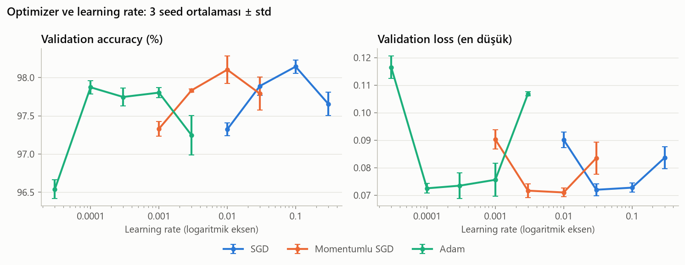

*Her nokta bir ayarın 3 seed ortalaması (en düşük validation loss'lu epoch'ta), hata çubukları ± standart sapma. Yatay eksen logaritmik.*

Her optimizer'ın en iyi learning rate'iyle:

| Seçenek | Val acc | Val loss (en düşük) | 1. epoch val acc | Train acc | En iyi epoch | Eğitim süresi (20 epoch) |
|---|---|---|---|---|---|---|
| SGD, lr = 0.1 | %98.14 ± 0.09 | 0.0728 ± 0.0017 | %93.94 ± 1.15 | %99.96 ± 0.04 | 11.0 ± 1.7 | 14.3 ± 0.0 sn |
| Momentumlu SGD, lr = 0.01 | %98.10 ± 0.18 | 0.0710 ± 0.0016 | %95.10 ± 0.48 | %99.92 ± 0.10 | 9.7 ± 1.5 | 14.7 ± 0.0 sn |
| Adam, lr = 0.0001 | %97.87 ± 0.09 | 0.0725 ± 0.0017 | %91.78 ± 0.11 | %99.65 ± 0.11 | 17.7 ± 1.2 | 16.5 ± 0.1 sn |

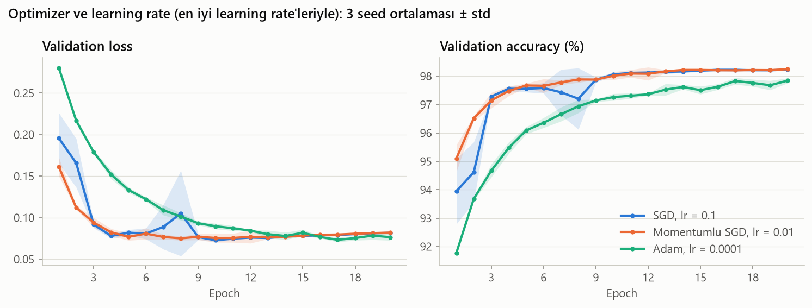

- **Momentumlu SGD'nin eğrisi, düz SGD'ninkinin 10 kat sola kaymış hâli.**
  - Düz SGD'de lr ile momentumlu SGD'de lr / 10 her seferinde neredeyse aynı sonucu veriyor: %97.32 ↔ %97.33, %97.89 ↔ %97.83, %98.14 ↔ %98.10, %97.66 ↔ %97.79.
  - Bu, momentum 0.9'un etkin adımı 10 katına çıkardığı öngörüsünü doğruluyor. İki optimizer da en iyi sonucu aynı etkin adımda (0.1) veriyor.
- **Adam learning rate'e en az duyarlı olan.**
  - 0.0001 ile 0.001 arasında (10 kat) sonuç %97.75–97.87 aralığında kalıyor.
  - SGD ve momentumlu SGD'de en iyi değerden 3 kat uzaklaşınca 0.25–0.48 puan kayboluyor.
  - Ancak Adam'ın en iyisi, diğer ikisinin en iyisine ulaşmıyor.
- **Adam'da learning rate, overfitting'in ne zaman başladığını belirliyor.**
  - lr 0.001'de en iyi epoch 5.3; sonrasında validation loss Deney 1'deki gibi yükseliyor.
  - lr 0.0001'de en iyi epoch 17.7. Overfitting gecikiyor ama model 20 epoch sınırına dayanıyor.
- **Düz SGD'de ani düşüş var, momentumlu SGD'de yok.**
  - SGD lr 0.1'de seed 2'nin validation accuracy'si 6. epoch'taki %97.5'ten 8. epoch'ta %96.0'a düşüyor ve 9. epoch'ta %97.9'a dönüyor (grafikte mavi gölgenin genişlediği yer). Aynı düşüş ön denemelerde de görüldü.
  - Momentumlu SGD'de böyle bir düşüş yok.
  - Olası açıklama: İki optimizer'ın etkin adımı aynı. Ancak momentum, gradyanları ~10 adım boyunca biriktirerek tek tek mini-batch'lerin gürültüsünü azaltıyor.

**Karar:**
1. **Birincil ölçüt üç optimizer'ı ayırt etmiyor.**
   - En iyi learning rate'leriyle: SGD %98.14, momentumlu SGD %98.10 (0.04 puan geride), Adam %97.87 (0.27 puan geride).
   - Farkların hepsi 0.3 puanlık eşiğin altında. Adam'ın farkı sınıra yakın.
2. **İkincil ölçütler:**

   | Ölçüt | SGD (lr 0.1) | Momentumlu SGD (lr 0.01) | Adam (lr 0.0001) |
   |---|---|---|---|
   | Yakınsama hızı (1. epoch val acc) | %93.94 ± 1.15 | **%95.10 ± 0.48** | %91.78 ± 0.11 |
   | Val loss (en düşük) | 0.0728 | 0.0710 | 0.0725 |
   | Eğitim süresi (20 epoch) | **14.3 sn** | 14.7 sn | 16.5 sn |
   | Sadelik (ek hiperparametre) | **yok** | momentum (0.9) | β₁, β₂, ε (varsayılan) |
   | Kararlılık | seed 2'de 1.6 puanlık ani düşüş | **pürüzsüz** | **pürüzsüz** |
   | Learning rate'e duyarlılık | 3 kat uzakta 0.25 / 0.48 puan kayıp | 3 kat uzakta 0.27 / 0.31 puan kayıp | **10 kat aralıkta ±0.1 puan** |

   - **Yakınsama hızı** momentumlu SGD'yi gösteriyor: 1. epoch'ta düz SGD'den 1.2, Adam'dan 3.3 puan önde. Aynı sıralama ön denemelerde de görüldü.
   - **Validation loss** farkları standart sapma (~0.002) düzeyinde; ayırt etmiyor.
   - **Eğitim süresi:** Momentumlu SGD düz SGD'den %3 yavaş, Adam ise %15 yavaş. Adam her ağırlık için iki hareketli ortalama tuttuğu için en çok hesabı yapıyor.
   - **Sadelik** düz SGD'nin, **learning rate'e duyarlılık** ise Adam'ın lehine.
3. **Seçilen: momentumlu SGD, lr = 0.01.**
   - Düz SGD seçilmedi: doğrulukta eşit, ama daha yavaş yakınsıyor ve eğitimi daha az kararlı.
   - Adam seçilmedi: doğrulukta eşiğin sınırında geride. En iyi learning rate'inde en yavaş yakınsayan ve en uzun süren seçenek.
   - Ödev şartı açısından: momentumlu SGD, `torch.optim.SGD`'nin momentum parametresiyle kullanılmış hâli. Yani "SGD veya Adam" şartı karşılanıyor.

**Sınırlar:**
- Momentum (0.9) ve Adam'ın β değerleri sabit tutuldu; ayarlanmadı.
- 20 epoch sınırı, düşük learning rate'leri dezavantajlı bırakıyor.
  - SGD lr 0.01 ve momentumlu SGD lr 0.001'de üç seed'in de en iyi epoch'u 20; Adam lr 0.0001'de ortalama 17.7.
  - Bu ayarlar daha uzun eğitimde yükselebilir. Epoch sayısı Bölüm 5.8'de ele alınacak.
- Learning rate eğitim boyunca sabit; zamanla azalan learning rate denenmedi.
- En iyi learning rate batch boyutuna bağlı olabilir (Bölüm 5.6). Optimizer, learning rate ve momentum Bölüm 6'da diğer ayarlarla birlikte yeniden aranacak.

**Not – aynı ayarın tekrarları:** Düz SGD lr 0.1 burada %98.14 verdi (5.1'de %98.13, 5.2'de %98.03). Adam lr 0.001 ise %97.80 verdi (Deney 1'de %97.83, 5.1'de %97.75, 5.2'de %97.68). Tekrarlar arasındaki farklar yine 0.15 puanın içinde.

### 5.4 Derinlik ve genişlik

**Soru:** Kaç gizli katman (derinlik) ve her katmanda kaç nöron (genişlik) olmalı?

**Tasarım:**
- 1–4 gizli katman × 64 / 128 / 256 / 512 / 1024 nöron ızgarası denendi.
- Her gizli katmanda aynı sayıda nöron var. Örneğin "3 katman × 256 nöron" = `784 → 256 → 256 → 256 → 10`. Böylece her model iki sayıyla tanımlanıyor ve derinliğin etkisi genişliğin etkisinden ayrı okunabiliyor.
- Toplam 20 model × 3 seed = 60 eğitim.
- Diğer bütün ayarlar Bölüm 5.3 sonundaki gibi: standardizasyon, cross-entropy, momentumlu SGD (lr = 0.01), batch 64, 20 epoch.
- **1 gizli katmanlı modeller ödev şartını sağlamıyor.** Yalnızca derinliğin ne kazandırdığını görmek için denendi; seçilemezler.

**Parametre sayısı:** `n` girdili, `m` çıktılı bir katmanda `n · m` ağırlık ve `m` bias var. Izgaradaki modeller 50 890 (1 × 64) ile 3 962 890 (4 × 1024) parametre arasında; yani aralarında ~78 kat fark var. Mevcut 256 → 128 modelinde 235 146 parametre var.
- Genişliği 2 katına çıkarmak, ilk katmanı (`784 · w`) 2 kat, iç katmanları (`w · w`) 4 kat büyütüyor.
- Bir katman eklemek `w² + w` parametre ekliyor: 64 nöronda ~4 bin, 1024 nöronda ~1 milyon.

**Hipotezler:**
- **(a) Kapasite:** Çok küçük modeller veriyi yeterince temsil edemeyebilir (underfitting). Büyük modeller ise regularization olmadan train setini daha kolay ezberler.
- **(b) Derinlik:** Tek gizli katmanlı bir ağ, yeterince genişse her sürekli fonksiyona istenen yakınlıkta yaklaşabilir (evrensel yaklaşım teoremi; Cybenko, 1989; Hornik, 1991). Teorem bunun için kaç nöron gerektiğini söylemiyor. Derinlik, özellikleri katman katman birleştirerek aynı işi daha az parametreyle yapabilir. MNIST görece kolay bir problem olduğu için derinliğin etkisinin küçük olması beklendi.
- **(c) Süre:** Küçük modellerde GPU kapasitesinin çok altında çalışıyor. Bu yüzden süre nöron sayısından çok, arka arkaya yapılan işlem sayısına, yani katman sayısına bağlı olabilir.

**Seçim kuralı (sonuçlardan önce belirlendi):**
1. Birincil ölçüt öncekilerle aynı. Seçilebilir modeller en az 2 gizli katmanlı olanlar (ödev şartı).
2. Seçilebilir modellerin en iyisine 0.3 puandan yakın olanlar "eşit derecede iyi" sayılır.
3. Bunlardan **en az parametreli** olan seçilir.
   - Fark gürültü düzeyindeyse, büyük modelin daha iyi olduğuna dair bir kanıt yok. Küçük model daha hızlı eğitiliyor ve ezberleme kapasitesi daha düşük.
   - Bu, model seçimindeki **"bir standart hata kuralı"**nın benzeri: hatası en iyi modelinkinden bir standart hata içinde kalan modellerin en sadesi seçilir (Hastie, Tibshirani ve Friedman, *The Elements of Statistical Learning*, 2009, Bölüm 7.10). Bizim 0.3 puanlık eşiğimiz aynı rolü oynuyor.
   - Bölüm 5.0'daki ikincil ölçütlerden "sadelik"in bu deneydeki karşılığı parametre sayısı. Seçenekler tam da boyutta ayrıldığı için belirleyici ölçüt o. 1. epoch accuracy bu deneyde adil bir hız ölçüsü değil: büyük model bir epoch'ta daha çok öğrenebilir, ama o epoch'u daha pahalıya yapar.

**Sonuçlar:**

| Seçenek | Parametre | Val acc | Val loss (en düşük) | 1. epoch val acc | Train acc | En iyi epoch | Eğitim süresi (20 epoch) |
|---|---|---|---|---|---|---|---|
| 1 katman × 64 nöron | 50 890 | %97.36 ± 0.06 | 0.0912 ± 0.0027 | %94.48 ± 0.21 | %99.26 ± 0.21 | 8.3 ± 1.2 | 11.3 ± 0.1 sn |
| 1 katman × 128 nöron | 101 770 | %97.91 ± 0.11 | 0.0756 ± 0.0015 | %94.93 ± 0.27 | %99.84 ± 0.10 | 11.0 ± 1.7 | 11.2 ± 0.0 sn |
| 1 katman × 256 nöron | 203 530 | %97.94 ± 0.11 | 0.0684 ± 0.0023 | %95.22 ± 0.25 | %99.82 ± 0.14 | 9.3 ± 2.1 | 11.4 ± 0.1 sn |
| 1 katman × 512 nöron | 407 050 | %98.12 ± 0.03 | 0.0650 ± 0.0015 | %95.41 ± 0.23 | %99.95 ± 0.02 | 10.7 ± 0.6 | 11.3 ± 0.0 sn |
| 1 katman × 1024 nöron | 814 090 | %98.20 ± 0.05 | 0.0628 ± 0.0009 | %95.69 ± 0.29 | %99.95 ± 0.04 | 9.7 ± 1.5 | 11.3 ± 0.1 sn |
| 2 katman × 64 nöron | 55 050 | %97.41 ± 0.15 | 0.0924 ± 0.0029 | %94.46 ± 0.38 | %99.44 ± 0.09 | 9.3 ± 0.6 | 13.5 ± 0.1 sn |
| 2 katman × 128 nöron | 118 282 | %97.60 ± 0.10 | 0.0780 ± 0.0029 | %94.91 ± 0.34 | %99.32 ± 0.15 | 6.3 ± 0.6 | 14.8 ± 0.1 sn |
| **2 katman × 256 nöron** | 269 322 | %97.99 ± 0.11 | 0.0700 ± 0.0016 | %95.21 ± 0.33 | %99.70 ± 0.31 | 7.7 ± 2.5 | 14.8 ± 0.1 sn |
| 2 katman × 512 nöron | 669 706 | %98.23 ± 0.20 | 0.0672 ± 0.0002 | %95.44 ± 0.30 | %99.92 ± 0.11 | 9.3 ± 2.1 | 14.7 ± 0.0 sn |
| 2 katman × 1024 nöron | 1 863 690 | %98.21 ± 0.17 | 0.0653 ± 0.0021 | %95.73 ± 0.32 | %99.92 ± 0.09 | 8.0 ± 2.0 | 14.8 ± 0.0 sn |
| 3 katman × 64 nöron | 59 210 | %97.28 ± 0.18 | 0.0913 ± 0.0054 | %93.60 ± 1.25 | %98.74 ± 0.30 | 6.0 ± 1.0 | 15.4 ± 0.1 sn |
| 3 katman × 128 nöron | 134 794 | %97.70 ± 0.10 | 0.0804 ± 0.0012 | %94.61 ± 0.69 | %99.42 ± 0.15 | 7.3 ± 1.2 | 18.1 ± 0.0 sn |
| 3 katman × 256 nöron | 335 114 | %97.81 ± 0.22 | 0.0743 ± 0.0023 | %94.97 ± 0.48 | %99.40 ± 0.28 | 6.0 ± 1.0 | 18.1 ± 0.1 sn |
| 3 katman × 512 nöron | 932 362 | %97.92 ± 0.11 | 0.0708 ± 0.0016 | %95.37 ± 0.36 | %99.53 ± 0.23 | 5.3 ± 1.5 | 18.3 ± 0.1 sn |
| 3 katman × 1024 nöron | 2 913 290 | %98.05 ± 0.11 | 0.0703 ± 0.0030 | %95.53 ± 0.37 | %99.74 ± 0.11 | 6.0 ± 1.0 | 18.1 ± 0.0 sn |
| 4 katman × 64 nöron | 63 370 | %97.22 ± 0.22 | 0.0954 ± 0.0062 | %92.84 ± 1.97 | %98.93 ± 0.19 | 7.3 ± 1.5 | 17.6 ± 0.1 sn |
| 4 katman × 128 nöron | 151 306 | %97.45 ± 0.15 | 0.0863 ± 0.0051 | %93.73 ± 1.76 | %99.22 ± 0.04 | 6.3 ± 0.6 | 21.8 ± 0.0 sn |
| 4 katman × 256 nöron | 400 906 | %97.75 ± 0.09 | 0.0784 ± 0.0011 | %94.50 ± 1.20 | %99.37 ± 0.25 | 5.7 ± 1.5 | 21.9 ± 0.1 sn |
| 4 katman × 512 nöron | 1 195 018 | %97.82 ± 0.10 | 0.0762 ± 0.0031 | %95.19 ± 0.70 | %99.48 ± 0.31 | 6.0 ± 1.7 | 21.8 ± 0.0 sn |
| 4 katman × 1024 nöron | 3 962 890 | %97.82 ± 0.19 | 0.0762 ± 0.0026 | %95.22 ± 0.94 | %99.54 ± 0.29 | 5.7 ± 2.1 | 22.0 ± 0.1 sn |

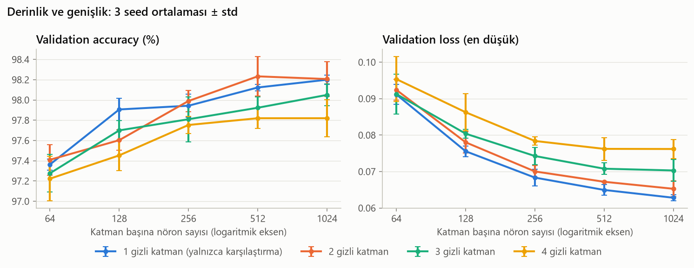

*Her nokta bir modelin 3 seed ortalaması (en düşük validation loss'lu epoch'ta), hata çubukları ± standart sapma. Yatay eksen logaritmik; her adım 2 kat.*

Her derinliğin en iyi modeli:

| Seçenek | Parametre | Val acc | Val loss (en düşük) | 1. epoch val acc | Train acc | En iyi epoch | Eğitim süresi (20 epoch) |
|---|---|---|---|---|---|---|---|
| 1 katman × 1024 nöron | 814 090 | %98.20 ± 0.05 | 0.0628 ± 0.0009 | %95.69 ± 0.29 | %99.95 ± 0.04 | 9.7 ± 1.5 | 11.3 ± 0.1 sn |
| 2 katman × 512 nöron | 669 706 | %98.23 ± 0.20 | 0.0672 ± 0.0002 | %95.44 ± 0.30 | %99.92 ± 0.11 | 9.3 ± 2.1 | 14.7 ± 0.0 sn |
| 3 katman × 1024 nöron | 2 913 290 | %98.05 ± 0.11 | 0.0703 ± 0.0030 | %95.53 ± 0.37 | %99.74 ± 0.11 | 6.0 ± 1.0 | 18.1 ± 0.0 sn |
| 4 katman × 512 nöron | 1 195 018 | %97.82 ± 0.10 | 0.0762 ± 0.0031 | %95.19 ± 0.70 | %99.48 ± 0.31 | 6.0 ± 1.7 | 21.8 ± 0.0 sn |

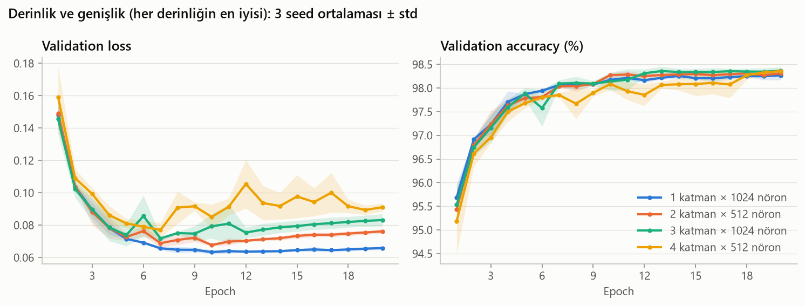

- **Genişlik önemli, ama bir yere kadar.** 2 katmanda doğruluk 64 nörondan 512 nörona çıkarken %97.41'den %98.23'e yükseliyor; 1024'te artık artmıyor (%98.21). Diğer derinliklerde de aynı eğilim var. Hipotez (a) doğrulandı: küçük modeller anlamlı şekilde kötü.
- **Derinlik bu problemde bir şey kazandırmadı.**
  - Aynı genişlikte 1 ve 2 katman en iyi. 3 ve 4 katman çoğu genişlikte daha kötü: 4 × 256 %97.75, 2 × 256 %97.99.
  - Tek gizli katmanlı 1 × 1024 (%98.20), ızgaranın en iyileri arasında. Hipotez (b) ile uyumlu: MNIST için tek bir geniş katman yeterli.
  - Derin modellerin validation loss'u da daha yüksek: 4 × 256'da 0.078, 2 × 256'da 0.070.
- **Derin modeller yavaş ve seed'e bağlı başlıyor.**
  - 1. epoch'ta 4 × 64 %92.84 ± 1.97, 1 × 64 %94.48 ± 0.21.
  - Sebep, PyTorch'un varsayılan başlangıç ağırlıkları. `nn.Linear` ağırlıkları `[−1/√n, 1/√n]` aralığından seçiliyor (varyans `1/(3n)`), ReLU da sinyalin yaklaşık yarısını sıfırlıyor. Hesaba göre sinyalin büyüklüğü her katmanda ~√6 ≈ 2.4 kat küçülüyor.
  - Eğitilmemiş bir 4 × 256 modelde 1 000 validation görüntüsüyle ölçüldü: katman çıkışlarının standart sapması 0.56 → 0.23 → 0.10 → 0.05 şeklinde küçülüyor. ReLU için önerilen He başlangıcıyla (He vd., 2015) ise her katmanda ~1.4'te sabit kalıyor.
  - Zayıf sinyal, küçük gradyan ve yavaş başlangıç demek. Bu ödevde başlangıç yöntemi ayrıca karşılaştırılmadı.
- **Süre katman sayısıyla artıyor, genişlikle neredeyse hiç değişmiyor.** 1 katmanlı modellerin hepsi ~11.3 sn, 2 katmanlılar ~14.8 sn, 3 katmanlılar ~18 sn, 4 katmanlılar ~22 sn sürüyor; 64 nöron da 1024 nöron da aynı süreyi alıyor. Hipotez (c) doğrulandı.
- **4 katmanlı modelin validation loss eğrisi** diğerlerinden yüksekte ve daha dalgalı seyrediyor.

**Karar:**
1. **En iyi seçilebilir model:** 2 × 512 (%98.23).
2. **Eşik içindeki modeller:** 2 × 256 (%97.99), 2 × 512, 2 × 1024 (%98.21) ve 3 × 1024 (%98.05). 3 × 512 (%97.92) 0.31 puanla eşiğin hemen dışında kaldı.
3. **Seçilen: 2 gizli katman × 256 nöron** (`784 → 256 → 256 → 10`, 269 322 parametre). Parametre sayısı 2 × 512'nin %40'ı, 2 × 1024'ün yedide biri.
   - **Daha büyük modeller seçilmedi:** Doğrulukta ayırt edilemiyorlar, ama 2.5–11 kat daha fazla parametreleri var.
   - **64 ve 128 nöronlu modeller seçilmedi:** Anlamlı şekilde kötüler (2 × 128, 0.63 puan geride).
   - **3 ve 4 katman seçilmedi:** Aynı genişlikte kazanç getirmiyorlar; daha yavaşlar ve val loss'ları daha yüksek.
   - **1 katman seçilemez:** ödev şartı.
   - Mevcut 256 → 128 modelinden tek farkı, ikinci katmanın 128 yerine 256 nöron olması.

**Sınırlar:**
- 2 × 256'nın farkı 0.24 puan, yani eşiğe yakın; tekrarlanan bir çalıştırmada 2 × 512 seçilebilirdi. Kural önceden belirlendiği için sonucu olduğu gibi aldık.
- Bütün modeller 256 → 128 modelinde seçilen learning rate (0.01) ile eğitildi. Çok farklı boyuttaki modellerin en iyi learning rate'i farklı olabilir.
- Başlangıç ağırlıkları PyTorch'un varsayılanı; He başlangıcı derin modellere yardım edebilirdi.
- Regularization yok. Büyük modeller regularization ile (Bölüm 5.7) daha iyi sonuç verebilir. Mimari, Bölüm 6'da diğer ayarlarla birlikte yeniden aranacak.

### 5.5 Aktivasyon fonksiyonu

**Soru:** Gizli katmanlarda hangi aktivasyon fonksiyonu kullanılmalı?

**Bu deney karar için değil, anlamak için yapıldı.** Ödev ReLU kullanılmasını şart koşuyor. Sigmoid ve Tanh, ReLU'nun neden tercih edildiğini görmek için denendi.

| Aktivasyon | Formül | Çıkış aralığı | Türevin en büyük değeri |
|---|---|---|---|
| Sigmoid | `1 / (1 + e^(−z))` | (0, 1) | 0.25 |
| Tanh | `(e^z − e^(−z)) / (e^z + e^(−z))` | (−1, 1) | 1 |
| ReLU | `max(0, z)` | [0, ∞) | 1 (z > 0 olan her yerde) |

Backpropagation'da gradyan her katmanda aktivasyonun türeviyle çarpılarak geriye taşınır.
- **Sigmoid:** Türev en fazla 0.25 olduğu için gradyan her katmanda en az 4 kat küçülür. Büyük `|z|` değerlerinde fonksiyon düzleşir (doygunluk) ve türev sıfıra yaklaşır. Çıkışları da hep pozitiftir.
- **Tanh:** Sıfır merkezli, ama o da doyar.
- **ReLU:** Pozitif tarafta doygunluk yok ve hesaplaması en ucuzu. Dezavantajı, negatif tarafta türevin 0 olması ("ölü ReLU", Bölüm 5.1).

**Gradyan ölçümü:** Eğitilmemiş, aynı başlangıç ağırlıklarına sahip 2 × 256 model üç aktivasyonla kuruldu. 1 000 validation görüntüsüyle bir kez backpropagation yapıldı ve her katmanın ağırlıklarına gelen gradyanın normu ölçüldü:

| | 1. katman | 2. katman | Çıkış katmanı |
|---|---|---|---|
| Sigmoid | **0.070** | 0.082 | 0.485 |
| Tanh | 0.879 | 0.505 | 0.500 |
| ReLU | 0.447 | 0.258 | 0.232 |

Sigmoid'de ilk katmana ulaşan gradyan, ReLU'dakinin ~1/6'sı. Gradyan çıkış katmanında büyük, ama geriye doğru giderken türevin çarpanıyla eriyor. Bu yüzden Sigmoid'in daha büyük bir learning rate'e ihtiyaç duyacağı beklendi.

**Tasarım:** Optimizer deneyindeki (5.3) gibi, her aktivasyon kendi learning rate aralığında denendi ve **kendi en iyi learning rate'iyle** karşılaştırıldı.
- Denenen learning rate'ler (momentumlu SGD): 0.003 / 0.01 / 0.03 / 0.1.
- Ön denemede Sigmoid'in en iyi değeri aralığın üst kenarında (0.1) çıktı. Bu yüzden Sigmoid için 0.3 de eklendi.
- Toplam 13 ayar × 3 seed = 39 eğitim.
- Diğer ayarlar Bölüm 5.4 sonundaki gibi: 2 × 256, batch 64, 20 epoch.

**Sonuçlar:**

| Seçenek | Val acc | Val loss (en düşük) | 1. epoch val acc | Train acc | En iyi epoch | Eğitim süresi (20 epoch) |
|---|---|---|---|---|---|---|
| ReLU, lr = 0.003 | %97.89 ± 0.07 | 0.0710 ± 0.0007 | %92.19 ± 0.32 | %99.81 ± 0.08 | 16.0 ± 1.7 | 15.0 ± 0.2 sn |
| ReLU, lr = 0.01 | %98.03 ± 0.11 | 0.0693 ± 0.0025 | %95.22 ± 0.32 | %99.71 ± 0.33 | 7.7 ± 2.5 | 14.8 ± 0.0 sn |
| ReLU, lr = 0.03 | %97.91 ± 0.07 | 0.0770 ± 0.0011 | %96.18 ± 0.34 | %99.51 ± 0.13 | 6.3 ± 0.6 | 14.8 ± 0.0 sn |
| ReLU, lr = 0.1 | %95.66 ± 0.45 | 0.1887 ± 0.0155 | %93.94 ± 0.73 | %96.67 ± 0.44 | 4.0 ± 1.7 | 14.9 ± 0.1 sn |
| Sigmoid, lr = 0.003 | %94.95 ± 0.05 | 0.1726 ± 0.0004 | %58.45 ± 3.63 | %95.72 ± 0.02 | 20.0 ± 0.0 | 14.7 ± 0.1 sn |
| Sigmoid, lr = 0.01 | %97.54 ± 0.09 | 0.0813 ± 0.0016 | %87.64 ± 0.39 | %99.18 ± 0.07 | 19.7 ± 0.6 | 14.7 ± 0.1 sn |
| Sigmoid, lr = 0.03 | %97.91 ± 0.08 | 0.0715 ± 0.0007 | %91.59 ± 0.20 | %99.91 ± 0.06 | 14.7 ± 2.1 | 14.7 ± 0.0 sn |
| Sigmoid, lr = 0.1 | %98.11 ± 0.09 | 0.0761 ± 0.0019 | %94.12 ± 1.38 | %99.99 ± 0.01 | 11.0 ± 1.0 | 14.7 ± 0.1 sn |
| Sigmoid, lr = 0.3 | %97.31 ± 0.27 | 0.1004 ± 0.0060 | %90.10 ± 4.12 | %99.27 ± 0.35 | 16.3 ± 3.2 | 14.8 ± 0.1 sn |
| Tanh, lr = 0.003 | %97.90 ± 0.06 | 0.0705 ± 0.0004 | %91.53 ± 0.08 | %99.90 ± 0.02 | 19.0 ± 1.0 | 14.8 ± 0.1 sn |
| Tanh, lr = 0.01 | %98.09 ± 0.09 | 0.0689 ± 0.0020 | %94.40 ± 0.13 | %99.93 ± 0.09 | 9.7 ± 1.5 | 14.8 ± 0.0 sn |
| Tanh, lr = 0.03 | %98.20 ± 0.06 | 0.0737 ± 0.0034 | %95.61 ± 0.48 | %100.00 ± 0.00 | 10.7 ± 0.6 | 14.7 ± 0.1 sn |
| Tanh, lr = 0.1 | %95.79 ± 0.41 | 0.1610 ± 0.0070 | %93.32 ± 0.87 | %96.79 ± 0.46 | 5.0 ± 2.6 | 14.8 ± 0.1 sn |

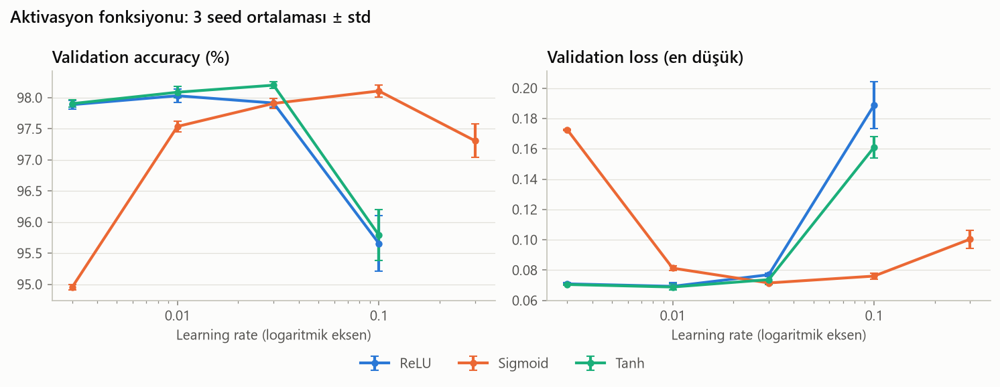

*Her nokta bir ayarın 3 seed ortalaması (en düşük validation loss'lu epoch'ta), hata çubukları ± standart sapma. Yatay eksen logaritmik.*

Her aktivasyonun en iyi learning rate'iyle:

| Seçenek | Val acc | Val loss (en düşük) | 1. epoch val acc | Train acc | En iyi epoch | Eğitim süresi (20 epoch) |
|---|---|---|---|---|---|---|
| ReLU, lr = 0.01 | %98.03 ± 0.11 | 0.0693 ± 0.0025 | %95.22 ± 0.32 | %99.71 ± 0.33 | 7.7 ± 2.5 | 14.8 ± 0.0 sn |
| Sigmoid, lr = 0.1 | %98.11 ± 0.09 | 0.0761 ± 0.0019 | %94.12 ± 1.38 | %99.99 ± 0.01 | 11.0 ± 1.0 | 14.7 ± 0.1 sn |
| Tanh, lr = 0.03 | %98.20 ± 0.06 | 0.0737 ± 0.0034 | %95.61 ± 0.48 | %100.00 ± 0.00 | 10.7 ± 0.6 | 14.7 ± 0.1 sn |

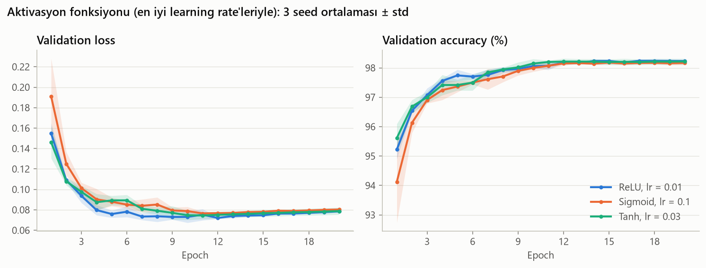

- **Aynı learning rate'te Sigmoid geride, kendi learning rate'inde değil.**
  - lr = 0.01'de Sigmoid %97.54; ReLU %98.03. 1. epoch'ta fark çok daha büyük: %87.64'e karşı %95.22.
  - lr = 0.003'te Sigmoid neredeyse öğrenemiyor: 1. epoch'ta %58, 20 epoch sonunda %94.95.
  - Sigmoid'in en iyi değeri lr = 0.1 (%98.11). Bu, ReLU'nun en iyi değerinin 10 katı ve gradyan ölçümüyle uyumlu.
  - Tek bir learning rate'te karşılaştırsaydık "Sigmoid kötü" derdik. Bu farkın büyük bölümü learning rate seçiminden kaynaklanıyor.
- **Tanh, ReLU kadar iyi:** En iyi değeri lr = 0.03'te %98.20.
- **Learning rate'e duyarlılık farklı:**
  - ReLU ve Tanh 0.003–0.03 aralığının tamamında %97.9–98.2 veriyor.
  - Sigmoid yalnızca 0.03–0.1 aralığında iyi.
  - lr = 0.1'de ReLU ve Tanh bozuluyor (%95.7–95.8); momentum 0.9 ile etkin adım ~1.0 oluyor.
- **Eğriler:** Sigmoid, en iyi learning rate'iyle bile 1. epoch'ta geride (%94.1'e karşı %95.2–95.6) ve seed'ler arası farkı büyük. ~10. epoch'tan sonra üç eğri birleşiyor.
- Bu deneyde üç aktivasyonun eğitim süresi aynı (~14.8 sn). Ön denemede Tanh ve Sigmoid ~%10 daha yavaştı. Bu, bu boyuttaki bir modelde süreyi aktivasyonun hesabından çok diğer işlemlerin belirlediğini gösteriyor.

**Karar:**
1. **Birincil ölçüt üç aktivasyonu ayırt etmiyor:** En iyi learning rate'leriyle Tanh %98.20, Sigmoid %98.11, ReLU %98.03. ReLU en iyiden 0.17 puan geride; fark eşiğin altında.
2. **Seçilen: ReLU, lr = 0.01** (ödev şartı; baseline'daki ayar korundu). ReLU için denenen learning rate'lerin en iyisi zaten 0.01.
3. **Ödev şartı olmasaydı da ReLU'yu seçmek için sebep var:**
   - **Learning rate'e duyarlılık:** ReLU geniş bir aralıkta iyi sonuç veriyor; Sigmoid dar bir aralıkta.
   - **Yakınsama hızı:** Aynı learning rate'te ReLU 1. epoch'ta ~7.6 puan önde. Sigmoid'in ilk katmanına ulaşan gradyan ~6 kat küçük.
   - **Derinlik:** Bu ağ yalnızca 2 katmanlı. Sigmoid'in gradyanı her katmanda en az 4 kat küçüldüğü için derin ağlarda fark büyür (kaybolan gradyan sorunu).

**Sınırlar:**
- Ağ sığ (2 katman); Sigmoid'in kaybolan gradyan sorunu derin ağlarda bu deneydekinden çok daha belirgin olur.
- Tanh sayıca en yüksek sonucu verdi, ama fark eşiğin altında ve ödev şartı nedeniyle Tanh seçilemez.

### 5.6 Batch boyutu

**Soru:** Her ağırlık güncellemesinde kaç görüntüye bakılmalı? (Şu ana kadar 64.)

Batch boyutunun üç etkisi var:
- **Gürültü:** Küçük batch'in gradyanı, bütün verinin gradyanından daha çok sapar.
- **Güncelleme sayısı:** Aynı learning rate ile büyük batch, epoch başına çok daha az adım atar. Batch 16'da epoch başına 3 125, batch 2048'de 25 güncelleme var.
- **Hız:** GPU, batch'teki görüntüleri paralel işler; epoch süresi batch büyüdükçe kısalır.

**Gradyan gürültüsü ölçümü:** Eğitilmemiş 2 × 256 model için 10 000 görüntünün gradyanı "gerçek" gradyan kabul edildi. Her batch boyutunda 20 rastgele batch'in gradyanının bundan göreli farkı ölçüldü:

| Batch | 16 | 32 | 64 | 128 | 256 | 512 | 1024 | 2048 |
|---|---|---|---|---|---|---|---|---|
| Epoch başına güncelleme | 3 125 | 1 563 | 782 | 391 | 196 | 98 | 49 | 25 |
| Gradyan hatası (göreli) | 2.59 | 1.78 | 1.28 | 0.89 | 0.64 | 0.47 | 0.34 | 0.24 |

Batch 4 kat büyüdükçe hata ~2 kat küçülüyor (hata ∝ 1/√batch): ortalama alınan örnek sayısı arttıkça tahminin gürültüsü kareköküyle azalır.

**Tasarım:** Batch boyutu değişince learning rate'in anlamı da değişir. Bu yüzden iki kural denendi:

| Kural | Learning rate | Mantığı |
|---|---|---|
| lr sabit | 0.01 | Tek değişken kuralına sadık: yalnızca batch değişir |
| lr batch ile orantılı | `0.01 × batch / 64` | Doğrusal ölçekleme kuralı (Goyal vd., 2017): batch k kat büyürse adım sayısı k kat azalır; learning rate de k kat büyütülerek epoch başına toplam ilerleme korunur |

- Batch boyutları 16'dan 2048'e kadar, her adımda 2 kat.
- İlk tasarımda en büyük batch 512'ydi. Ön denemede aşağıdaki kuralın seçtiği ayar aralığın üst kenarında (512) çıktığı için 1024 ve 2048 eklendi.
- Batch 64'te iki kural aynı ayarı veriyor. Toplam 8 + 7 = 15 ayar × 3 seed = 45 eğitim.
- Diğer ayarlar Bölüm 5.5 sonundaki gibi: 2 × 256, ReLU, momentumlu SGD, 20 epoch.

**Seçim kuralı (sonuçlardan önce belirlendi):** Birincil ölçüt val accuracy. En iyiye 0.3 puandan yakın ayarlar eşit derecede iyi sayılır. Batch boyutunun asıl pratik etkisi hız olduğu için, bunlardan **en hızlı eğitilen** seçilir. Bu, Bölüm 5.4'teki "eşit derecede iyiyse en ucuzu" kuralının aynısı; orada maliyet parametre sayısıydı, burada eğitim süresi.

**Sonuçlar:**

| Seçenek | Val acc | Val loss (en düşük) | 1. epoch val acc | Train acc | En iyi epoch | Eğitim süresi (20 epoch) |
|---|---|---|---|---|---|---|
| Batch 16, lr = 0.01 | %97.70 ± 0.11 | 0.0819 ± 0.0052 | %96.12 ± 0.30 | %99.30 ± 0.13 | 4.7 ± 0.6 | 60.3 ± 0.8 sn |
| Batch 32, lr = 0.01 | %98.19 ± 0.10 | 0.0742 ± 0.0011 | %95.87 ± 0.81 | %99.88 ± 0.12 | 9.0 ± 2.0 | 36.7 ± 1.1 sn |
| Batch 64, lr = 0.01 | %97.99 ± 0.11 | 0.0700 ± 0.0016 | %95.21 ± 0.33 | %99.70 ± 0.31 | 7.7 ± 2.5 | 16.1 ± 1.7 sn |
| Batch 128, lr = 0.01 | %98.00 ± 0.07 | 0.0703 ± 0.0027 | %93.45 ± 0.16 | %99.85 ± 0.15 | 13.0 ± 3.0 | 7.5 ± 0.1 sn |
| Batch 256, lr = 0.01 | %97.81 ± 0.09 | 0.0712 ± 0.0014 | %91.37 ± 0.24 | %99.80 ± 0.03 | 18.0 ± 1.0 | 3.4 ± 0.0 sn |
| Batch 512, lr = 0.01 | %97.50 ± 0.05 | 0.0822 ± 0.0026 | %89.23 ± 0.05 | %99.03 ± 0.05 | 20.0 ± 0.0 | 1.9 ± 0.0 sn |
| Batch 1024, lr = 0.01 | %96.35 ± 0.06 | 0.1187 ± 0.0012 | %83.39 ± 0.38 | %97.46 ± 0.02 | 20.0 ± 0.0 | 1.0 ± 0.1 sn |
| Batch 2048, lr = 0.01 | %94.62 ± 0.07 | 0.1800 ± 0.0016 | %67.53 ± 2.78 | %95.40 ± 0.01 | 20.0 ± 0.0 | 0.5 ± 0.0 sn |
| Batch 16, lr = 0.0025 | %98.00 ± 0.05 | 0.0690 ± 0.0014 | %95.09 ± 0.42 | %99.81 ± 0.15 | 8.3 ± 1.5 | 61.5 ± 0.7 sn |
| Batch 32, lr = 0.005 | %97.98 ± 0.07 | 0.0700 ± 0.0019 | %95.06 ± 0.58 | %99.67 ± 0.27 | 7.3 ± 2.5 | 30.5 ± 0.1 sn |
| Batch 128, lr = 0.02 | %97.95 ± 0.07 | 0.0704 ± 0.0014 | %95.10 ± 0.25 | %99.74 ± 0.13 | 7.7 ± 1.2 | 7.6 ± 0.0 sn |
| Batch 256, lr = 0.04 | %98.03 ± 0.06 | 0.0697 ± 0.0012 | %94.77 ± 0.14 | %99.83 ± 0.08 | 8.3 ± 0.6 | 3.4 ± 0.0 sn |
| **Batch 512, lr = 0.08** | %97.90 ± 0.10 | 0.0728 ± 0.0003 | %94.62 ± 0.09 | %99.73 ± 0.16 | 8.0 ± 2.0 | 1.9 ± 0.0 sn |
| Batch 1024, lr = 0.16 | %97.87 ± 0.15 | 0.0773 ± 0.0006 | %93.43 ± 0.28 | %99.81 ± 0.11 | 9.3 ± 1.5 | 1.0 ± 0.0 sn |
| Batch 2048, lr = 0.32 | %96.73 ± 0.25 | 0.1144 ± 0.0091 | %79.02 ± 9.89 | %98.66 ± 0.37 | 10.7 ± 2.1 | 0.5 ± 0.0 sn |

*İlk 8 satır lr sabit (0.01), son 7 satır lr batch ile orantılı.*

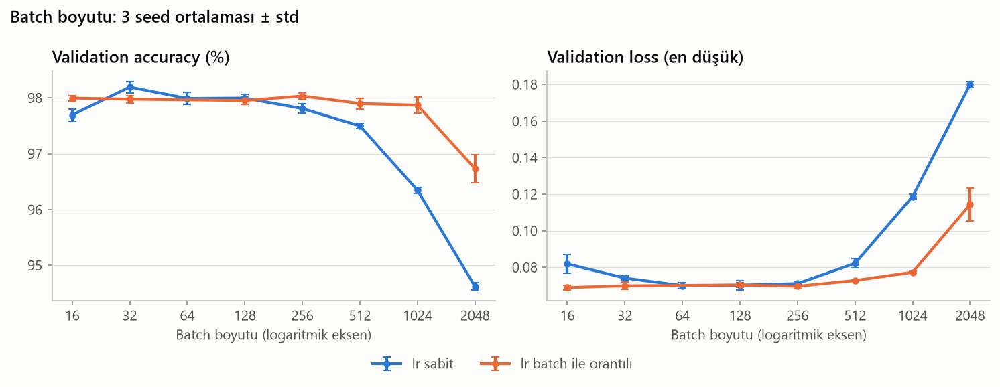

*Her nokta bir ayarın 3 seed ortalaması (en düşük validation loss'lu epoch'ta), hata çubukları ± standart sapma. Yatay eksen logaritmik; her adım 2 kat. Orantılı lr çizgisinde batch 64 noktası yok; o ayar sabit lr ile aynı.*

Her kuralın en iyisi:

| Seçenek | Val acc | Val loss (en düşük) | 1. epoch val acc | Train acc | En iyi epoch | Eğitim süresi (20 epoch) |
|---|---|---|---|---|---|---|
| Batch 32, lr = 0.01 | %98.19 ± 0.10 | 0.0742 ± 0.0011 | %95.87 ± 0.81 | %99.88 ± 0.12 | 9.0 ± 2.0 | 36.7 ± 1.1 sn |
| Batch 256, lr = 0.04 | %98.03 ± 0.06 | 0.0697 ± 0.0012 | %94.77 ± 0.14 | %99.83 ± 0.08 | 8.3 ± 0.6 | 3.4 ± 0.0 sn |

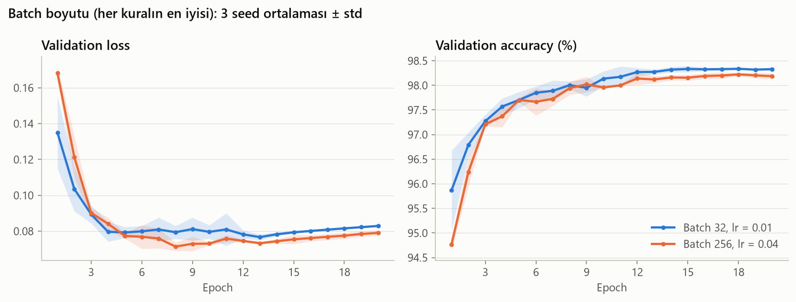

- **Sabit learning rate'te büyük batch'ler yetişemiyor.**
  - 32–128 arası ~%98.0–98.2. 256'dan itibaren düşüş başlıyor: 512'de %97.50, 1024'te %96.35, 2048'de %94.62.
  - En iyi epoch 512 ve üstünde 20; modeller eğitim bittiğinde hâlâ gelişiyordu.
  - Sebep güncelleme sayısı: 20 epoch'ta batch 2048 yalnızca 500 güncelleme yapıyor, batch 64 ise 15 640.
- **Sabit learning rate'te çok küçük batch de iyi değil.** Batch 16'da en iyi epoch ~5 ve val loss yüksek (0.082). Her epoch'ta 3 125 güncelleme ve gürültülü gradyanlarla model çok hızlı ilerleyip hızlı overfit ediyor.
- **Orantılı learning rate'te batch'in etkisi kayboluyor.**
  - Batch 16'dan 1024'e kadar bütün ayarlar %97.9–98.0. En iyi epoch her batch'te ~8.
  - Doğrusal ölçekleme kuralı epoch başına ilerlemeyi gerçekten sabit tutuyor.
  - Batch 2048'de (lr = 0.32) eğitim kararsızlaşıyor: 1. epoch'ta seed'ler arasında ±10 puan fark var, sonuç %96.73. Momentum 0.9 ile etkin adım ~3.2'ye çıkıyor; kuralın bir sınırı var.
- **Süre, batch her 2 katına çıktığında yaklaşık yarıya iniyor:** batch 16'da ~61 sn, 64'te ~16 sn, 512'de ~1.9 sn, 2048'de ~0.5 sn. Aynı batch boyutunda iki kural aynı sürede bitiyor; süreyi learning rate değil, batch boyutu belirliyor.

**Karar:**
1. **Birincil ölçüt:** En iyi ayar batch 32, lr = 0.01 (%98.19). 15 ayarın 8'i en iyiye 0.3 puandan yakın.
2. **Eşit derecede iyi ayarların en hızlısı:** batch 512, lr = 0.08 (%97.90, en iyiden 0.29 puan geride, ~1.9 sn).
3. **Seçilen: batch 512, lr = 0.08** (learning rate batch ile orantılı).
   - **Küçük batch'ler seçilmedi:** Doğrulukta ayırt edilemiyorlar, ama 2–30 kat daha yavaşlar.
   - **Batch 1024 seçilmedi:** %97.87 ile en iyiden 0.32 puan geride, eşiğin hemen dışında. (Ön denemede 0.22 puan gerideydi ve seçilmişti; sınırda bir sonuç.)
   - **Batch 2048 seçilmedi:** iki kuralda da kararsız ya da yetersiz.
   - **Sabit learning rate ile büyük batch'ler seçilmedi:** güncelleme sayısı yetmiyor.

**Pratik etkisi:** Bir eğitim ~16 sn yerine ~2 sn sürüyor. Sonraki deneyler ve Bölüm 6'daki ortak arama ~8 kat daha hızlı olacak.

**Sınırlar:**
- Seçilen ayar eşiğe çok yakın (0.29 puan) ve validation loss'u en iyilerden biraz yüksek (0.073'e karşı ~0.070). Tekrarlanan bir çalıştırmada başka bir batch boyutu seçilebilirdi.
- Momentum 0.9'da sabit tutuldu. Büyük batch'lerde learning rate ısınması (warm-up; Goyal vd., 2017) kararlılığı artırabilirdi; denenmedi.
- Küçük batch'in gürültüsünün regularization etkisi (Keskar vd., 2017) bu problemde görülmedi.

### 5.7 Regularization

**Soru:** Overfitting'i azaltan bir yöntem eklenmeli mi? (Şu ana kadar hiçbiri yok.)

Deney 1'den beri bütün eğrilerde aynı tablo var: train accuracy %99.5'in üstüne çıkıyor, validation loss ise ~8–10. epoch'tan sonra yükseliyor. En düşük val loss'lu epoch'u seçmek bunun zararını sınırlıyor (bir tür early stopping), ama overfitting'in kendisini azaltmıyor.

**Denenen yöntemler** (her biri tek başına; tek değişken kuralı):

| Yöntem | Ne yapar | Denenen güçler |
|---|---|---|
| Dropout (Srivastava vd., 2014) | Eğitimde her adımda gizli nöronların rastgele bir kısmını (oran p) sıfırlar. Ağ tek tek nöronlara güvenemez, bilgiyi birçok nörona yaymak zorunda kalır. Değerlendirmede kapalı. | p = 0.1 / 0.2 / 0.5 |
| Weight decay (L2) | Her adımda ağırlıkları sıfıra doğru çeker; loss'a (λ/2)·Σw² eklemekle aynı. Girdideki küçük değişikliklere aşırı tepki veren büyük ağırlıkları cezalandırır. | λ = 0.0001 / 0.0005 / 0.002 |
| Batch normalization (Ioffe ve Szegedy, 2015) | Her gizli katmanın çıkışını batch'in ortalaması ve standart sapmasıyla standartlaştırır. Asıl amacı optimizasyonu kolaylaştırmak; batch'ten batch'e değişen istatistikler hafif bir regularization etkisi de yaratır. | açık |
| Veri artırma | Modeli değil veriyi değiştirir: her batch'teki her train görüntüsü rastgele döndürülür, kaydırılır ve ölçeklenir. Model aynı rakamın her epoch biraz farklı bir hâlini görür. Değerlendirmede kapalı. | hafif (±10°, ±2 piksel, ±%10) / orta (±15°, ±3 piksel, ±%15) / güçlü (±20°, ±4 piksel, ±%20) |

- Gizli katmanların sırası: Linear → (batch normalization) → ReLU → (dropout).
- Veri artırma GPU'da, batch hâlinde yapılıyor ([`src/augment.py`](src/augment.py)). Her görüntü için döndürme açısı, kaydırma ve ölçek, verilen aralıkta düzgün dağılımdan ayrı ayrı seçiliyor. Görüntü tek bir affine dönüşümle yeniden örnekleniyor; dışarıda kalan yerler arka planla dolduruluyor.
- Veri artırma ilk tasarımda yoktu. El yazısı değerlendirmesinin (Bölüm 8) hazırlığında yapılan bir ön denemede doğruluğu belirgin şekilde artırdığı görülünce, bu deney çalıştırılmadan önce seçeneklere eklendi.
- Toplam 11 ayar × 3 seed = 33 eğitim. Diğer ayarlar Bölüm 5.6 sonundaki gibi: 2 × 256, ReLU, momentumlu SGD, batch 512, lr = 0.08, 20 epoch.

**Karar kuralı (sonuçlardan önce belirlendi):** Birincil ölçüt val accuracy, eşik 0.3 puan. Fark anlamsızsa ikincil ölçütler: validation loss (regularization'ın asıl hedefi), yakınsama hızı, eğitim süresi. Ayırt edici bir fayda yoksa "yok" (mevcut ayar) korunur.

**Sonuçlar:**

| Seçenek | Val acc | Val loss (en düşük) | 1. epoch val acc | Train acc | En iyi epoch | Eğitim süresi (20 epoch) |
|---|---|---|---|---|---|---|
| Yok | %97.97 ± 0.04 | 0.0722 ± 0.0010 | %94.61 ± 0.09 | %99.83 ± 0.05 | 9.0 ± 1.0 | 1.9 ± 0.1 sn |
| Dropout 0.1 | %98.12 ± 0.02 | 0.0659 ± 0.0008 | %94.70 ± 0.15 | %99.69 ± 0.26 | 9.7 ± 3.5 | 2.0 ± 0.0 sn |
| Dropout 0.2 | %98.08 ± 0.16 | 0.0659 ± 0.0027 | %94.57 ± 0.10 | %99.60 ± 0.20 | 10.0 ± 2.6 | 2.0 ± 0.0 sn |
| Dropout 0.5 | %97.93 ± 0.10 | 0.0707 ± 0.0021 | %93.84 ± 0.23 | %99.30 ± 0.01 | 16.3 ± 0.6 | 2.0 ± 0.0 sn |
| Weight decay 0.0001 | %98.13 ± 0.04 | 0.0694 ± 0.0002 | %94.56 ± 0.13 | %99.95 ± 0.06 | 12.0 ± 1.7 | 1.9 ± 0.0 sn |
| Weight decay 0.0005 | %98.11 ± 0.01 | 0.0627 ± 0.0005 | %94.56 ± 0.11 | %99.98 ± 0.01 | 17.3 ± 2.1 | 1.9 ± 0.0 sn |
| Weight decay 0.002 | %97.94 ± 0.09 | 0.0687 ± 0.0012 | %94.53 ± 0.13 | %99.45 ± 0.08 | 17.0 ± 1.0 | 1.9 ± 0.0 sn |
| Batch normalization | %98.22 ± 0.06 | 0.0635 ± 0.0011 | %96.37 ± 0.11 | %100.00 ± 0.00 | 10.7 ± 1.5 | 2.3 ± 0.0 sn |
| **Veri artırma (hafif)** | %98.94 ± 0.08 | 0.0364 ± 0.0018 | %94.08 ± 1.13 | %99.17 ± 0.04 | 17.3 ± 1.5 | 2.6 ± 0.0 sn |
| Veri artırma (orta) | %98.65 ± 0.10 | 0.0446 ± 0.0027 | %93.39 ± 0.88 | %98.79 ± 0.04 | 17.3 ± 1.5 | 2.6 ± 0.0 sn |
| Veri artırma (güçlü) | %98.23 ± 0.05 | 0.0568 ± 0.0034 | %90.67 ± 2.12 | %98.35 ± 0.08 | 17.3 ± 1.5 | 2.6 ± 0.0 sn |

Her yöntemin en iyisi:

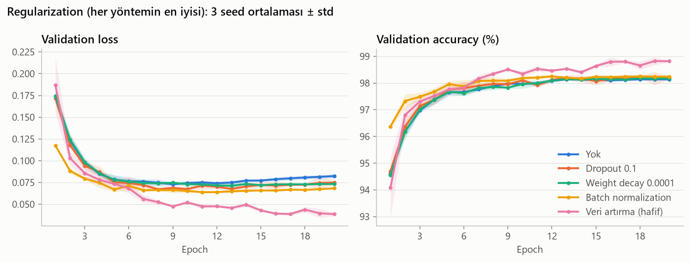

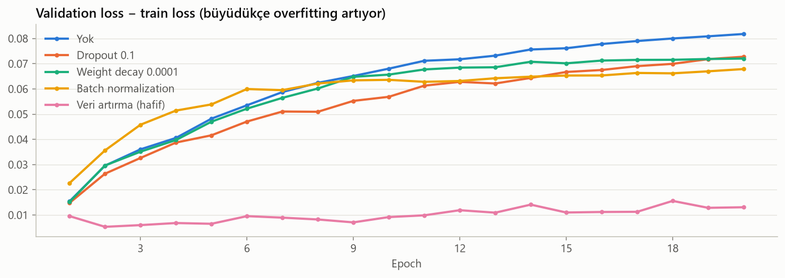

*Alttaki grafik: her epoch'ta validation loss ile train loss arasındaki fark (3 seed ortalaması). Train loss, eval modunda ve veri artırma uygulanmamış train görüntülerinde ölçülüyor; bu yüzden bütün yöntemler aynı şekilde karşılaştırılabiliyor.*

- **Regularization olmadan overfitting açık.** Train loss 20. epoch'ta ~0.0006'ya iniyor; val loss 9. epoch'tan sonra yükseliyor (en düşük 0.072, 20. epoch'ta 0.082). Train–validation farkı sürekli büyüyor: 5. epoch'ta 0.048, 20. epoch'ta 0.082.
- **Dropout ve weight decay biraz yardımcı oluyor.**
  - En iyi güçleri (dropout 0.1, weight decay 0.0001 ve 0.0005) ~%98.1; "yok"tan ~0.15 puan iyi, eşiğin altında.
  - Train–validation farkını 20. epoch'ta ~0.07'ye indiriyorlar. Weight decay 0.0005 val loss'u en çok düşüren model kısıtlayıcı yöntem (0.063).
- **Fazlası zarar veriyor.** Dropout 0.5 ve weight decay 0.002 farkı en çok küçültüyor (20. epoch'ta 0.051 ve 0.044). Ama val accuracy "yok"un da altına iniyor (%97.93 ve %97.94), train accuracy de düşüyor (%99.30 ve %99.45). Model artık yeterince öğrenemiyor (underfitting). Regularization'ın gücü, ezberleme ile öğrenememe arasında bir denge.
- **Batch normalization en hızlı başlayan.**
  - 1. epoch'ta val acc %96.37 (diğerlerinde ~%94.6), val loss 0.117 (diğerlerinde ~0.17).
  - Model kısıtlayan yöntemlerin en iyisi (%98.22), ama train–validation farkını pek küçültmüyor (20. epoch'ta 0.068; train accuracy %100).
  - Faydası overfitting'i önlemekten çok optimizasyonu kolaylaştırmaktan geliyor.
- **Veri artırma açık ara önde.**
  - Hafif %98.94 ("yok"tan 0.97 puan iyi), orta %98.65, güçlü %98.23. En düşük val loss neredeyse yarıya iniyor (0.072'den 0.036'ya).
  - Train–validation farkı bütün eğitim boyunca ~0.01: overfitting fiilen yok. Train accuracy %99.17; model train setini ezberleyemiyor.
  - İlk epoch'larda biraz geride başlıyor (1. epoch %94.08 ± 1.13; güçlüde %90.67). ~7. epoch'ta öne geçiyor ve farkı açıyor.
  - Val loss 20. epoch'ta hâlâ iniyor; en iyi epoch ~17. Model 20 epoch'ta henüz bitmemiş olabilir (Bölüm 5.8).
  - Güç arttıkça sonuç kötüleşiyor. Büyük dönüşümler rakamları MNIST'teki rakamlardan uzaklaştırıyor; model, validation'da hiç görmeyeceği hâlleri öğrenmeye kapasite harcıyor ve daha yavaş öğreniyor.
- **Süre:** Veri artırma 20 epoch'a ~0.7 sn ekliyor (1.9'dan 2.6 sn'ye), batch normalization ~0.4 sn. Dönüşümler GPU'da batch hâlinde yapıldığı için maliyet küçük.

**Karar:**
1. **Birincil ölçüt:** En iyi veri artırma (hafif), %98.94.
   - Veri artırma (orta) 0.29 puan geride: eşiğin hemen içinde, fark anlamlı değil.
   - Diğer bütün seçenekler anlamlı şekilde kötü: güçlü veri artırma 0.71, batch normalization 0.72, weight decay 0.0001 0.81, dropout 0.1 0.82, "yok" 0.97 puan geride.
2. **İkincil ölçütler (hafif ile orta arasında):**

   | Ölçüt | Veri artırma (hafif) | Veri artırma (orta) |
   |---|---|---|
   | Validation loss (en düşük) | **0.0364 ± 0.0018** | 0.0446 ± 0.0027 |
   | Yakınsama hızı (1. epoch val acc) | **%94.08 ± 1.13** | %93.39 ± 0.88 |
   | Eğitim süresi | 2.6 sn | 2.6 sn |

   Validation loss'ta hafif açıkça önde (fark, seed'ler arasındaki standart sapmanın ~3 katı). 1. epoch'ta da biraz önde, ama oradaki fark seed gürültüsünden küçük.
3. **Seçilen: veri artırma, hafif güçte** (±10° döndürme, ±2 piksel kaydırma, ±%10 ölçekleme).
   - **Orta seçilmedi:** Doğrulukta eşiğin hemen içinde, ama her ölçütte hafifin gerisinde.
   - **Güçlü seçilmedi:** Anlamlı şekilde kötü.
   - **Dropout, weight decay ve batch normalization seçilmedi:** "Yok"tan iyiler, ama veri artırmanın 0.7 puan ve daha fazla gerisindeler.

**Neden bu kadar etkili?** Dropout ve weight decay modeli kısıtlıyor; ezberlemeyi zorlaştırıyorlar ama modele yeni bir şey öğretmiyorlar. Veri artırma ise doğru bir ön bilgi ekliyor: biraz eğik, kaymış ya da büyümüş bir rakam hâlâ aynı rakam. MLP'nin girdisi düz bir 784'lük vektör olduğu için bu bilgi modelin yapısında yok: rakam bir piksel kayınca MLP için bambaşka bir girdi oluşuyor. (CNN'lerde kaymaya karşı duyarsızlık katmanların yapısından gelir; bu ödevde CNN kullanılmıyor.) Veri artırma bu duyarsızlığı modele veri yoluyla öğretiyor. Bu sağlamlık, kendi el yazımla yapılacak değerlendirmede (Bölüm 8) daha da önemli olacak.

**Sınırlar:**
- Yöntemler tek tek denendi. Birlikte kullanımları (ör. veri artırma ile dropout ya da batch normalization) Bölüm 6'daki ortak aramada denenecek.
- Veri artırmalı modeller 20. epoch'ta hâlâ gelişiyordu; 20 epoch sınırı onları dezavantajlı bırakıyor. Epoch sayısı Bölüm 5.8'de ele alınıyor.
- Hafif ile orta arasındaki fark (0.29 puan) eşiğe çok yakın; batch 1024 ile yapılan ilk ön denemede orta biraz öndeydi. Veri artırmanın diğer yöntemlere üstünlüğü ise ön denemelerde de açıktı.

### 5.8 Epoch sayısı, early stopping ve model seçme ölçütü

**Üç soru:**
1. **Epoch sayısı:** 20 epoch yetiyor mu? Bölüm 5.7'de veri artırmalı model 20. epoch'ta hâlâ gelişiyordu.
2. **Early stopping:** Eğitimi sabit bir epoch'ta bitirmek yerine, validation sonucu iyileşmeyi bıraktığında durdurmak daha mı iyi?
3. **Model seçme ölçütü:** Deney 1'den beri en iyi epoch'u en düşük validation **loss**'a göre seçiyoruz. En yüksek validation **accuracy**'ye göre seçmek daha mı iyi?

**Yöntem: bir uzun eğitim, birçok kural.** Bölüm 5.7 sonundaki ayar (veri artırma, hafif) 3 seed ile **100 epoch** eğitildi; her epoch'un ölçümleri kaydedildi. Her kural bu kaydın üzerinde sonradan uygulandı ([`src/epoch_secimi.py`](src/epoch_secimi.py)):
- "20 epoch, en düşük val loss": kaydın ilk 20 epoch'una bak, val loss'un en düşük olduğu epoch'u seç.
- "Early stopping, patience 5": kaydı baştan oku; ölçüt 5 epoch üst üste iyileşmezse dur, o ana kadarki en iyi epoch'u seç.

Bu, kuralı eğitim sırasında uygulamakla aynı sonucu veriyor: early stopping eğitimi yalnızca erken keser, kesilene kadarki epoch'lar birebir aynıdır.

**Validation seti ikiye bölündü** (5 000 + 5 000 görüntü, sabit rastgele bölme):
- **Seçim yarısı:** Kurallar epoch'u buna bakarak seçiyor.
- **Holdout yarısı:** Seçilen epoch'un gerçekte ne kadar iyi olduğu buna bakarak ölçülüyor.

Bir kural epoch'u bir veriye bakarak seçiyorsa, aynı verideki sonucu iyimser olur (**seçim yanlılığı**). "En yüksek val accuracy" kuralı örneğin 100 gürültülü sayının en büyüğünü seçiyor; o sayı kısmen şans. Kuralları adil karşılaştırmak için seçime karışmamış bir veri gerekiyor. Test seti kullanılamayacağı için validation'ın yarısı ayrıldı.

**Karşılaştırılan kurallar:**

| Grup | Kurallar | Hangi soruya cevap? |
|---|---|---|
| Sabit epoch, en düşük val loss | 10 / 20 (mevcut) / 40 / 100 epoch | Kaç epoch yeterli? |
| Sabit epoch, en yüksek val acc | 20 / 100 epoch | Seçim ölçütü loss mu, accuracy mi? |
| Early stopping (en fazla 100 epoch) | val loss ya da val acc; patience 5 ya da 10 | Ne zaman durmalı? |

*Patience: ölçüt kaç epoch üst üste iyileşmezse durulacağı.*

**Karar kuralı (sonuçlardan önce belirlendi):**
1. Birincil ölçüt **holdout accuracy**. En iyisine 0.3 puandan yakın kurallar eşit derecede iyi.
2. Seçilen kural Bölüm 6'da çok farklı ayarlarla kullanılacak. Sabit bir epoch sayısı yalnızca bu ayar için doğru olabilir: düşük learning rate'li bir ayar 20 epoch'ta yetişemeyebilir, yüksek olan 10 epoch'ta overfit edebilir. Early stopping her ayara kendiliğinden uyum sağlıyor. Bu yüzden eşit derecede iyi kurallardan **early stopping kuralları** tercih edilir.
3. Eşit derecede iyi early stopping kurallarından **en kısa sürede biten** seçilir.

**100 epoch'luk eğitim:**

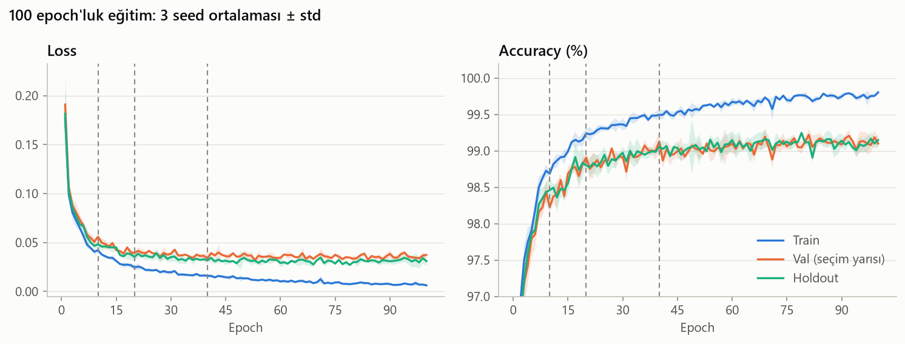

*Kesikli dikey çizgiler 10, 20 ve 40. epoch'lar.*

- **Train accuracy yavaş yükseliyor:** 100. epoch'ta ~%99.8, train loss ~0.006. Veri artırma yüzünden model train setini hızla ezberleyemiyor.
- **Validation loss uzun süre iniyor, sonra düzleşiyor.** Seçim yarısında 20. epoch'ta ~0.040, 40. epoch'ta ~0.034. Deney 1'deki gibi yükselişe geçmiyor; veri artırmasız modellerde val loss ~9. epoch'ta en düşüktü (Bölüm 5.7).
- **Validation accuracy** 20. epoch'ta ~%98.8, 40. epoch'ta ~%99.0; sonra %99.0–99.2 arasında dalgalanıyor.
- **Seed'lerin en düşük val loss'lu epoch'ları çok farklı: 40, 84 ve 58.** Val loss uzun bir düzlükte olduğu için en düşük noktası neredeyse rastgele bir yere düşüyor.
- **Eğriler epoch'tan epoch'a zikzaklı.** Her epoch'ta farklı rastgele dönüşümler kullanıldığı için ağırlıklar epoch'tan epoch'a biraz farklı yerlere gidiyor.
- **Holdout yarısının loss'u bütün eğitim boyunca seçim yarısınınkinden biraz düşük.** Rastgele bölünen iki yarının zorluğu biraz farklı. Bu yüzden seçim yanlılığı, iki yarının farkıyla değil, aynı kuralın iki ölçütle seçilmiş hâlleri karşılaştırılarak değerlendirildi.

**Kuralların sonuçları:**

| Kural | Durduğu epoch | Seçilen epoch | Val acc (seçim yarısı) | Holdout acc | Holdout loss | Eğitim süresi |
|---|---|---|---|---|---|---|
| 10 epoch, en düşük val loss | 10.0 ± 0.0 | 8.7 ± 0.6 | %98.45 ± 0.14 | %98.35 ± 0.04 | 0.0483 ± 0.0020 | 1.4 ± 0.1 sn |
| 20 epoch, en düşük val loss (mevcut) | 20.0 ± 0.0 | 17.7 ± 1.2 | %98.81 ± 0.12 | %99.02 ± 0.02 | 0.0348 ± 0.0009 | 2.8 ± 0.1 sn |
| 40 epoch, en düşük val loss | 40.0 ± 0.0 | 39.3 ± 1.2 | %99.15 ± 0.10 | %99.05 ± 0.06 | 0.0317 ± 0.0009 | 5.4 ± 0.2 sn |
| 100 epoch, en düşük val loss | 100.0 ± 0.0 | 60.7 ± 22.1 | %99.21 ± 0.07 | %99.12 ± 0.07 | 0.0318 ± 0.0014 | 13.4 ± 0.2 sn |
| 20 epoch, en yüksek val acc | 20.0 ± 0.0 | 19.7 ± 0.6 | %98.93 ± 0.03 | %98.87 ± 0.13 | 0.0362 ± 0.0027 | 2.8 ± 0.1 sn |
| 100 epoch, en yüksek val acc | 100.0 ± 0.0 | 83.0 ± 15.1 | %99.29 ± 0.04 | %99.13 ± 0.11 | 0.0310 ± 0.0052 | 13.4 ± 0.2 sn |
| **Early stopping: val loss, patience 5** | 32.0 ± 11.4 | 27.0 ± 11.4 | %99.03 ± 0.15 | %99.04 ± 0.07 | 0.0333 ± 0.0016 | 4.4 ± 1.5 sn |
| Early stopping: val loss, patience 10 | 39.7 ± 9.3 | 29.7 ± 9.3 | %99.07 ± 0.12 | %98.96 ± 0.17 | 0.0347 ± 0.0034 | 5.4 ± 1.3 sn |
| Early stopping: val acc, patience 5 | 31.3 ± 11.8 | 26.3 ± 11.8 | %99.03 ± 0.15 | %98.98 ± 0.16 | 0.0336 ± 0.0021 | 4.3 ± 1.6 sn |
| Early stopping: val acc, patience 10 | 47.7 ± 9.7 | 37.7 ± 9.7 | %99.15 ± 0.09 | %98.95 ± 0.17 | 0.0328 ± 0.0049 | 6.5 ± 1.1 sn |

*Eğitim süresi: kural durana kadar geçen süre. Sıralama ve seçim: [`results/karsilastirma/4a8_epoch/kurallar.md`](results/karsilastirma/4a8_epoch/kurallar.md).*

- **10 epoch yetmiyor:** En iyiden 0.78 puan geride; anlamlı şekilde kötü olan tek kural.
- **20 epoch'tan sonrası küçük bir kazanç.**
  - 20 epoch (mevcut) holdout'ta %99.02; en iyiden (%99.13) yalnızca 0.11 puan geride, eşiğin içinde.
  - Daha uzun eğitim holdout loss'u düşürüyor: 20 epoch'ta 0.0348, 40 ve 100 epoch'ta ~0.032.
  - Accuracy'deki kazanç ise 0.1 puan civarında; 3 seed ile ayırt edilemiyor.
- **Early stopping kuralları ortalama 31–48. epoch'ta duruyor.** Val loss ile patience 5'te seed'ler 24, 45 ve 27. epoch'ta duruyor; süre 100 epoch'un üçte biri.
- **Val loss ile val acc'ye bakan patience 5 kuralları bu çalıştırmada neredeyse aynı.**
  - İki seed'de aynı epoch'ta durup aynı epoch'u seçiyorlar.
  - Üçüncü seed'de val acc kuralı 2 epoch erken duruyor (25'e karşı 27) ve holdout'ta biraz kötü.
  - Ön denemede ise val acc'ye bakan patience 5 anlamlı şekilde kötüydü (~0.4 puan): val accuracy epoch'tan epoch'a zıpladığı için kural gürültüyü "iyileşme yok" sanıp erken durmuştu.

**Seçim yanlılığı:** Aynı kural iki ölçütle uygulandığında, seçim yarısındaki accuracy ile holdout accuracy arasındaki fark (pozitifse kural kendi seçtiği veride iyimser görünüyor):

| Kural | Val loss ile seçince | Val acc ile seçince |
|---|---|---|
| 20 epoch | −0.21 | +0.05 |
| 100 epoch | +0.09 | +0.15 |
| Early stopping, patience 5 | −0.01 | +0.05 |
| Early stopping, patience 10 | +0.11 | +0.19 |

- Dört karşılaştırmanın dördünde de val acc ile seçim daha iyimser (0.06–0.26 puan). Beklenen bu: val accuracy, birkaç görüntünün doğru ya da yanlış sınıflanmasıyla zıplayan gürültülü bir ölçü. En yükseğini seçmek, şansı da seçmek demek. Val loss ise her görüntüye verilen olasılığa bakan, daha pürüzsüz bir ölçü.
- Holdout'ta ise iki ölçüt eşit: val acc ile seçmek daha iyi bir model bulmuyor (100 epoch'ta %99.13'e karşı %99.12, patience 5'te %98.98'e karşı %99.04).
- Farklar küçük ve 3 seed × 5 000 görüntüyle gürültülü; tek başına kesin bir sonuç değil, ama yön her satırda aynı.

**Karar:**
1. **Birincil ölçüt:** En iyi kural "100 epoch, en yüksek val acc" (holdout %99.13). 10 epoch dışındaki 9 kural eşiğin içinde.
2. **Early stopping kuralları tercih edilir.** Dört early stopping kuralının dördü de eşiğin içinde.
3. **En hızlısı:** Val acc ile patience 5 (4.3 sn), hemen ardından val loss ile patience 5 (4.4 sn).
4. **Süre bu iki kuralı ayırt etmiyor.**
   - 0.1 sn'lik fark, tek bir seed'in 2 epoch erken durmasından geliyor. Seed'ler arasındaki oynama ±1.5 sn.
   - Bölüm 5.0'ın 6. kuralına göre ayırt edilemeyen seçeneklerde mevcut ayarda kalınıyor. Mevcut seçim ölçütü val loss.
   - Kodun ilk hâli bu durumu öngörmemişti ve mekanik olarak 0.1 sn hızlı olan val acc kuralını seçti. Bu yüzden seçim fonksiyonuna, **sonuçlar görüldükten sonra**, şu adım eklendi: süre farkı seed'ler arasındaki standart sapmadan küçükse, mevcut ölçütü kullanan en hızlı kural seçilir (`choose_policy`).
   - Diğer göstergeler de aynı yönde: holdout'ta val loss kuralı biraz yüksek ve seed'ler arasında daha kararlı (%99.04 ± 0.07'ye karşı %98.98 ± 0.16). Ön denemede de val acc kuralı erken durup anlamlı şekilde kötü kalmıştı.
5. **Seçilen: early stopping, val loss, patience 5, en fazla 100 epoch.** Val loss 5 epoch üst üste iyileşmezse eğitim durur ve en düşük val loss'lu epoch'un modeli alınır.
   - **Sabit 20 epoch (mevcut) seçilmedi:** Eşiğin içinde ve daha hızlı (2.8 sn). Ama sabit bir epoch sayısı, Bölüm 6'daki farklı ayarlara uyum sağlamaz (karar kuralının 2. adımı). Holdout loss'u da daha yüksek (0.0348'e karşı 0.0333). Ön denemede 0.32 puanla eşiğin dışındaydı.
   - **Sabit 40 ve 100 epoch seçilmedi:** Doğrulukta eşit, ama sabit; 100 epoch ~3 kat uzun sürüyor.
   - **Patience 10 seçilmedi:** Eşit derecede iyi, ama daha uzun sürüyor (5.4 sn).
   - **Val acc ölçütü seçilmedi:** Holdout'ta daha iyi bir model bulmuyor ve kendi seçtiği veride daha iyimser.

**4A'nın sonucu: Deney 1'den buraya.** Sekiz kararın hepsi birlikte:

| | Deney 1 (baseline) | 4A'nın sonucu |
|---|---|---|
| Girdi normalizasyonu | Standardizasyon | Standardizasyon |
| Loss | Cross-entropy | Cross-entropy |
| Optimizer | Adam, lr = 0.001 | Momentumlu SGD (0.9), lr = 0.08 |
| Mimari | 256 → 128 | 256 → 256 |
| Aktivasyon | ReLU | ReLU |
| Batch boyutu | 64 | 512 |
| Regularization | Yok | Veri artırma (hafif) |
| Eğitim kuralı | 20 epoch, en düşük val loss | Early stopping (val loss, patience 5), en fazla 100 epoch |
| Validation accuracy | %97.83 ± 0.21 | %99.04 ± 0.07 (holdout yarısı) |
| Eğitim süresi | ~16.5 sn | ~4.4 sn |

Doğruluk ~1.2 puan arttı, eğitim süresi ~4 kat kısaldı. Kazancın büyük kısmı veri artırmadan (Bölüm 5.7), hızın büyük kısmı batch boyutundan (Bölüm 5.6) geliyor.

**Sınırlar:**
- Kurallar yalnızca bu tek ayarda karşılaştırıldı. Patience 5, gürültüsü daha büyük ayarlarda erken durabilir; Bölüm 6'da aynı kural bütün denemelere uygulanacak.
- 3 seed ve 5 000 görüntülük yarılarla 0.1 puanlık farklar gürültü düzeyinde; holdout standart sapmaları 0.17'ye kadar çıkıyor.
- Seçim adımlarından biri (süre farkının anlamlı sayılmaması) sonuçlar görüldükten sonra eklendi. Bu adım olmasa seçilecek kural (val acc, patience 5) da eşiğin içindeydi; iki kural bu çalıştırmada üç seed'in ikisinde birebir aynı sonucu verdi.

## 6. Ortak Hiperparametre Araması

Kod: [`src/arama.py`](src/arama.py) · Çalıştırma: `python src/arama.py ara` (arama), `python src/arama.py dogrula` (doğrulama) · Ham sonuçlar: [`results/arama/`](results/arama/)

**Neden?** Bölüm 5'te her deneyde yalnızca bir ayar değişti. Bu yöntem ayarlar arasındaki **etkileşimleri** göremez. Bunun iki örneği zaten görüldü: en iyi learning rate aktivasyona (Bölüm 5.5) ve batch boyutuna (Bölüm 5.6) bağlıydı. Belki büyük bir model tek başına faydasızken (Bölüm 5.4) güçlü bir regularization ile birlikte faydalıdır. Bunu görmenin yolu ayarları birlikte değiştirmek. Ama bütün bileşimleri denemek imkânsız: 11 ayarın her biri için yalnızca 4 değer bile ~4 milyon bileşim demek. Bu yüzden sınırlı sayıda deneme yapan bir **arama yöntemi** kullanıldı.

### 6.1 Yöntem

**İki arama yöntemi** karşılaştırıldı (Optuna kütüphanesi):
- **Rastgele arama** (Bergstra ve Bengio, 2012): Her deneme, arama uzayından bağımsız ve rastgele seçilmiş bir ayar. Önceki denemelerden bir şey öğrenmez. Izgara aramasından daha verimli: ayarların yalnızca birkaçı önemliyse, ızgara aynı önemli değerleri tekrar tekrar dener; rastgele arama ise her denemede önemli ayarın da farklı bir değerini dener.
- **TPE** (Tree-structured Parzen Estimator; Bergstra vd., 2011): İlk 10 deneme rastgele. Sonra denemeleri "iyi" (en iyi %25) ve "kötü" olarak ikiye ayırır, her ayar için iki grupta hangi değerlerin sık olduğunu öğrenir ve bir sonraki denemeyi "iyilerde sık, kötülerde seyrek" değerlerden seçer. Zamanla umut verici bölgelere yoğunlaşır.

**Adil karşılaştırma:**
- İki yöntem aynı arama uzayını, aynı bütçeyi (30'ar deneme) ve aynı veriyi kullanıyor.
- Her deneme tek bir eğitim (seed 0). Eğitim kuralı Bölüm 5.8'inki: en fazla 100 epoch, val loss'a göre early stopping (patience 5). Bir denemenin skoru, en düşük val loss'lu epoch'taki validation accuracy.
- İki yöntem aynı sampler seed'ini kullandığı için **ilk 10 deneme ikisinde aynı.** Bu bilinçli bir tasarım (eşleştirilmiş karşılaştırma): iki yöntem aynı bilgiyle başlıyor; 11. denemeden itibaren aradaki her fark yöntemden geliyor.
- Test seti yüklenmedi.

**Arama uzayı** (aralıklar Bölüm 5'e göre seçildi):

| Ayar | Aralık | Gerekçe |
|---|---|---|
| Gizli katman sayısı | 2–4 | Ödev şartı en az 2; Bölüm 5.4'te 3–4 katman 2 katmandan iyi değildi (regularization olmadan) |
| Katman başına nöron | 128 / 256 / 512 / 1024 | Bölüm 5.4'te 64 nöron anlamlı şekilde kötüydü |
| Optimizer | momentumlu SGD / Adam | Bölüm 5.3'te ikisi de rekabetçiydi |
| Batch boyutu | 64 / 128 / 256 / 512 / 1024 | Bölüm 5.6: orantılı learning rate ile 16–512 eşit derecede iyiydi, 1024 sınırdaydı; 16–32 çok yavaş |
| Learning rate (momentumlu SGD) | batch 64'e göre 0.002–0.05 (logaritmik), sonra `× batch / 64` | Bölüm 5.6'nın doğrusal ölçekleme kuralı; Bölüm 5.3'teki iyi bölgenin bir kat dışı |
| Learning rate (Adam) | 0.00003–0.01 (logaritmik) | Bölüm 5.3'teki iyi bölgenin bir kat dışı |
| Momentum | 0.8–0.98 | Bölüm 5'te hep 0.9'du |
| Dropout | 0–0.5 | Bölüm 5.7 |
| Weight decay | 0.000001–0.01 (logaritmik) | Bölüm 5.7 |
| Batch normalization | var / yok | Bölüm 5.7 |
| Veri artırma | yok / hafif / orta / güçlü | Bölüm 5.7 |

Sabit kalanlar: ReLU (ödev şartı), cross-entropy, standardizasyon ve Bölüm 5.8'in eğitim kuralı.

- **SGD'nin learning rate'i neden "batch 64'e göre"?** SGD'de iyi learning rate batch ile orantılı (Bölüm 5.6). Learning rate doğrudan aransaydı, batch 1024 ile çok küçük ya da batch 64 ile çok büyük değerler sık sık denenirdi. Bunun yerine "batch 64 olsaydı learning rate ne olurdu?" değeri aranıyor ve gerçek değer batch'e göre ölçekleniyor. Adam'da adım büyüklüğü gradyanın ölçeğinden bağımsız olduğu için onun learning rate'i doğrudan aranıyor.
- **Logaritmik aralık neden?** Learning rate ve weight decay'in etkisi çarpımsal: 0.001 ile 0.002 arasındaki fark, 0.1 ile 0.101 arasındakinden çok daha önemli. Logaritmik örnekleme her büyüklük basamağına eşit şans verir.

**Seçim yanlılığı:** 60 denemenin en iyisi, kısmen şanslı bir seed sayesinde en iyi çıkmış olabilir. Bu yüzden aramanın skorları final karar için kullanılmadı; en iyi ayarlar Bölüm 6.3'te yeni seed'lerle yeniden ölçüldü.

### 6.2 Arama sonuçları

| Yöntem | En iyi val acc | İlk 10 denemenin ortalaması | Son 10 denemenin ortalaması | Öğrenemeyen deneme | Toplam süre |
|---|---|---|---|---|---|
| Rastgele arama | %99.08 | %96.70 | %97.95 | 1 | 5.4 dk |
| TPE | %99.29 | %96.70 | %98.99 | 0 | 16.2 dk |

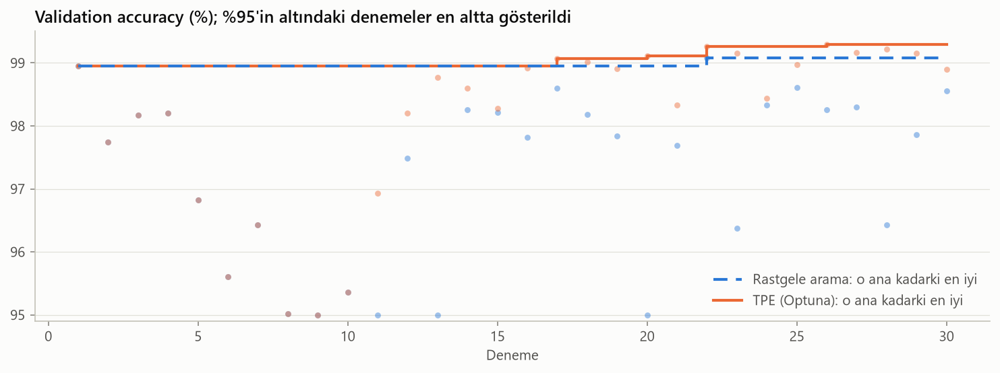

*Noktalar tek tek denemeler (1–10'daki koyu noktalar iki yöntemin üst üste binen ortak denemeleri). Basamaklı çizgiler o ana kadarki en iyi sonuç; rastgele aramanınki kesikli. %95'in altındaki denemeler en altta gösterildi.*

- **Rastgele aramanın denemeleri çok dağınık:** %93–99 arası, bir deneme hiç öğrenemedi (momentum 0.98 ile lr 0.74). Kötü bir bileşim (ör. yüksek weight decay, güçlü veri artırma ile büyük learning rate) kolayca 1–5 puan kaybettiriyor. Rastgele arama öğrenmediği için son 10 denemesinin ortalaması (%97.95) ile ilk 10'unki (%96.70) arasındaki fark tesadüf.
- **TPE 11. denemeden sonra bir bölgeye yoğunlaşıyor:**
  - 13. denemeden itibaren neredeyse hepsi batch normalization ve veri artırma kullanıyor.
  - 16. denemeden itibaren 2–4 × 1024, 17. denemeden itibaren çoğunlukla batch 64.
  - 25. denemeden itibaren Adam'a geçip learning rate'i ~0.0002'ye yerleştiriyor.
  - Son 10 denemesinin ortalaması %98.99, rastgele aramanınkinden ~1 puan yüksek.
- **En iyi deneme:** TPE %99.29, rastgele arama %99.08. Bu fark tek bir denemeye ve tek bir seed'e dayanıyor; buna çok güvenilmemeli (Bölüm 6.3).
- **TPE 3 kat uzun sürdü** (16.2 dk'ya karşı 5.4 dk). Bulduğu bölge (batch 64, 1024 nöron) epoch başına daha yavaş eğitilen ayarlardan oluşuyor; batch 64'lü denemeler 21–90 sn sürdü.
- **TPE'nin izlediği yol ilk denemelerin küçük farklarına duyarlı.** Aynı kodla yapılan bir ön denemede TPE, aynı ilk 10 denemeden sonra başka bir bölgeye (3–4 × 512, momentumlu SGD, batch 128) yoğunlaşmıştı. Aynı ayar farklı süreçlerde GPU hesaplarındaki küçük farklar yüzünden biraz farklı sonuç veriyor; bu da TPE'nin önerilerini değiştiriyor. İki bölge de tek seed'de ~%99.2–99.4'e ulaştı: birden fazla iyi bölge var.

**En iyi 10 deneme:**

| # | Yöntem | Deneme | Ayar | Parametre | Val acc (tek seed) | En iyi epoch / eğitilen | Süre |
|---|---|---|---|---|---|---|---|
| 1 | TPE | 26 | 2 × 1024, Adam, lr 0.00022, batch 64, dropout 0.30, wd 1e-06, BN, veri artırma hafif | 1 867 786 | %99.29 | 42 / 47 | 72.0 sn |
| 2 | TPE | 22 | 2 × 1024, mSGD (m = 0.94), lr 0.03, batch 64, dropout 0.38, wd 2e-05, BN, veri artırma hafif | 1 867 786 | %99.26 | 28 / 33 | 43.3 sn |
| 3 | TPE | 28 | 3 × 1024, Adam, lr 0.00021, batch 64, dropout 0.26, wd 2e-05, BN, veri artırma hafif | 2 919 434 | %99.22 | 38 / 43 | 73.5 sn |
| 4 | TPE | 27 | 3 × 1024, Adam, lr 0.00021, batch 64, dropout 0.22, wd 5e-05, BN, veri artırma hafif | 2 919 434 | %99.17 | 22 / 27 | 46.9 sn |
| 5 | TPE | 23 | 2 × 1024, mSGD (m = 0.94), lr 0.026, batch 64, dropout 0.30, wd 3e-05, BN, veri artırma hafif | 1 867 786 | %99.16 | 22 / 27 | 36.2 sn |
| 6 | TPE | 29 | 4 × 1024, Adam, lr 0.00021, batch 64, dropout 0.23, wd 2e-06, BN, veri artırma hafif | 3 971 082 | %99.16 | 30 / 35 | 59.3 sn |
| 7 | TPE | 20 | 2 × 1024, mSGD (m = 0.94), lr 0.027, batch 64, dropout 0.44, wd 2e-06, BN, veri artırma hafif | 1 867 786 | %99.11 | 22 / 27 | 33.7 sn |
| 8 | Rastgele arama | 22 | 4 × 512, mSGD (m = 0.84), lr 0.045, batch 128, dropout 0.09, wd 6e-05, BN, veri artırma orta | 1 199 114 | %99.08 | 35 / 40 | 36.6 sn |
| 9 | TPE | 17 | 2 × 1024, mSGD (m = 0.94), lr 0.013, batch 64, dropout 0.35, wd 7e-06, BN, veri artırma orta | 1 867 786 | %99.07 | 21 / 26 | 35.1 sn |
| 10 | TPE | 18 | 2 × 1024, mSGD (m = 0.93), lr 0.034, batch 64, dropout 0.49, wd 1e-05, BN, veri artırma orta | 1 867 786 | %99.02 | 37 / 42 | 59.2 sn |

*mSGD: momentumlu SGD, m: momentum, wd: weight decay, BN: batch normalization. "En iyi epoch / eğitilen": ör. 42 / 47, 42. epoch en düşük val loss'luydu; 5 epoch beklenip 47'de durdu.*

En iyi 10 denemenin 9'u TPE'den geldi ve hepsi birbirine benziyor: 2–4 × 1024 (biri 4 × 512), batch 64–128, batch normalization, dropout 0.1–0.5, veri artırma (hafif ya da orta).

**Hangi ayar ne kadar önemli?**

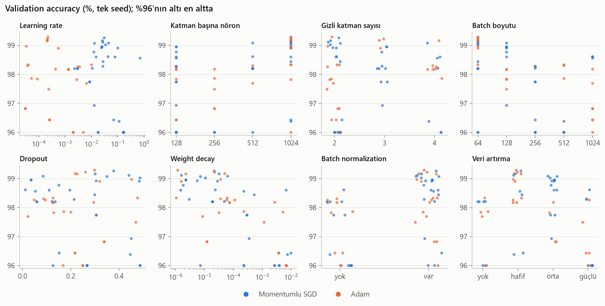

*Her nokta bir deneme (tek seed); mavi momentumlu SGD, turuncu Adam. %96'nın altındaki denemeler en altta gösterildi.*

Sayılar, 50 farklı denemenin (ortak ilk 10 bir kez sayıldı) başarılı 49'undan:

| Ayar | Değer | Deneme | En iyi | Ortanca |
|---|---|---|---|---|
| Batch normalization | var | 34 | %99.29 | %98.60 |
| | yok | 15 | %98.61 | %97.82 |
| Veri artırma | yok | 9 | %98.33 | %97.86 |
| | hafif | 16 | %99.29 | %98.94 |
| | orta | 14 | %99.08 | %98.69 |
| | güçlü | 10 | %98.61 | %96.96 |
| Weight decay | ≤ 0.001 | 38 | %99.29 | %98.50 |
| | > 0.001 | 11 | %98.60 | %96.43 |

- **Batch normalization ve veri artırma** en belirgin etkiler. Batch normalization'sız ve veri artırmasız en iyi denemeler, ikisini de kullananların ortancasına bile yetişemiyor. Güçlü veri artırma, Bölüm 5.7'deki gibi zararlı.
- **Weight decay 0.001'in üstünde belirgin şekilde zararlı.**
- **Optimizer:** Bölüm 5.3'te (regularization olmadan) Adam momentumlu SGD'nin biraz gerisindeydi (fark anlamlı değildi). Burada batch normalization ve dropout ile, learning rate ~0.0002'de, en iyi deneme Adam'dan geldi. Momentumlu SGD de neredeyse aynı yerde (en iyisi %99.26).
- **Genişlik:** En iyiler 1024 nöronda. Bölüm 5.4'te 2 × 512 ve 2 × 1024 de en iyiler arasındaydı ama 2 × 256'dan anlamlı şekilde iyi değildi. Burada regularization ile birlikte büyük modeller en üstte: aradığımız türden bir **etkileşim** olabilir.
- **Dikkat:** Bu grafikler nedensellik göstermez. Her denemede birçok ayar aynı anda değişiyor; bir panelde görülen eğilim başka bir ayardan kaynaklanıyor olabilir. Ayrıca TPE iyi bölgeden çok örneklediği için, o bölgenin ayarları grafiklerde fazla temsil ediliyor (ör. 1024 nöron ve batch 64).

**Ara sonuç:** Arama, 4A'nın sonucundan (2 × 256, batch 512, yalnızca veri artırma) farklı bir bölge buldu: daha büyük modeller, küçük batch ve birlikte kullanılan birkaç regularization yöntemi. Ama skorlar tek seed'lik ve 60 denemenin en iyileri seçildiği için iyimser. Bu ayarların 4A'nın sonucundan gerçekten daha iyi olup olmadığı Bölüm 6.3'te yeni seed'lerle ölçüldü.

### 6.3 En iyi ayarların yeni seed'lerle doğrulanması

**Neden?** Aramadaki her deneme tek bir seed'le eğitildi. Aynı ayar farklı bir seed'le ±0.1–0.2 puan farklı sonuç verebiliyor. 60 sayının en büyükleri seçildiğinde, şansı yaver gitmiş denemeler de seçilir. Buna **kazananın laneti** (winner's curse) denir: en iyi denemenin skoru, o ayarın gerçek ortalamasından yüksek çıkar.

**Yöntem:**
- Aramada tek seed'le en yüksek validation accuracy'yi veren 5 farklı ayar ve karşılaştırma için 4A'nın sonucu (Bölüm 5.8 sonundaki ayar), aramada **hiç kullanılmamış** 3 yeni seed (1, 2, 3) ile yeniden eğitildi: 6 × 3 = 18 eğitim.
- **Seçim kuralı (sonuçlardan önce belirlendi; Bölüm 5.4 ile aynı):** En iyiye 0.3 puandan yakın ayarlardan **en az parametreli** olan seçilir; parametre sayısı eşitse doğruluğu yüksek olan. Eşit derecede iyi modellerden en sadesi: daha hızlı eğitilir ve çalışır, ezberlemeye daha az eğilimlidir.

**Kazananın laneti:**

| Ayar | Aramada (tek seed) | Yeniden ölçüm (3 yeni seed) | Fark |
|---|---|---|---|
| TPE #26 | %99.29 | %99.15 | −0.14 |
| TPE #22 | %99.26 | %99.14 | −0.12 |
| TPE #28 | %99.22 | %99.00 | −0.22 |
| TPE #27 | %99.17 | %99.08 | −0.09 |
| TPE #23 | %99.16 | %99.18 | +0.02 |

- Beş ayarın dördünün skoru düştü; ortalama düşüş 0.11 puan. 60 denemenin en iyilerini seçerken şanslı seed'leri de seçmiştik; yeni seed'lerde o şans yok (ortalamaya doğru geri dönüş).
- **Sıralama değişti:** Aramada beşinci olan TPE #23 yeniden ölçümde birinci; aramanın birincisi (TPE #26) ikinci. Yeniden ölçmeden seçseydik, gerçekte en iyi olmayan bir ayarı seçmiş olabilirdik.

**Sonuçlar:**

- **TPE #26:** 2 × 1024, Adam, lr 0.00022, batch 64, dropout 0.30, wd 1e-06, BN, veri artırma hafif
- **TPE #22:** 2 × 1024, mSGD (m = 0.94), lr 0.03, batch 64, dropout 0.38, wd 2e-05, BN, veri artırma hafif
- **TPE #28:** 3 × 1024, Adam, lr 0.00021, batch 64, dropout 0.26, wd 2e-05, BN, veri artırma hafif
- **TPE #27:** 3 × 1024, Adam, lr 0.00021, batch 64, dropout 0.22, wd 5e-05, BN, veri artırma hafif
- **TPE #23:** 2 × 1024, mSGD (m = 0.94), lr 0.026, batch 64, dropout 0.30, wd 3e-05, BN, veri artırma hafif
- **4A sonucu:** 2 × 256, mSGD (m = 0.90), lr 0.08, batch 512, dropout 0, weight decay 0, veri artırma hafif

| Seçenek | Parametre | Val acc | Val loss (en düşük) | 1. epoch val acc | Train acc | En iyi epoch | Eğitim süresi |
|---|---|---|---|---|---|---|---|
| TPE #26 | 1 867 786 | %99.15 ± 0.04 | 0.0275 ± 0.0010 | %96.53 ± 0.16 | %99.43 ± 0.11 | 27.0 ± 5.0 | 43.1 ± 6.7 sn |
| TPE #22 | 1 867 786 | %99.14 ± 0.06 | 0.0269 ± 0.0012 | %96.01 ± 0.29 | %99.45 ± 0.05 | 28.7 ± 4.9 | 43.0 ± 8.0 sn |
| TPE #28 | 2 919 434 | %99.00 ± 0.08 | 0.0293 ± 0.0023 | %96.63 ± 0.27 | %99.24 ± 0.15 | 19.3 ± 3.8 | 38.2 ± 5.8 sn |
| TPE #27 | 2 919 434 | %99.08 ± 0.11 | 0.0282 ± 0.0022 | %96.69 ± 0.14 | %99.33 ± 0.18 | 21.7 ± 6.5 | 42.0 ± 10.1 sn |
| TPE #23 | 1 867 786 | %99.18 ± 0.07 | 0.0249 ± 0.0025 | %96.14 ± 0.26 | %99.53 ± 0.10 | 35.7 ± 11.2 | 50.4 ± 14.2 sn |
| **4A sonucu** | **269 322** | %98.89 ± 0.16 | 0.0357 ± 0.0047 | %93.93 ± 0.89 | %99.26 ± 0.30 | 24.0 ± 14.1 | 3.6 ± 1.8 sn |

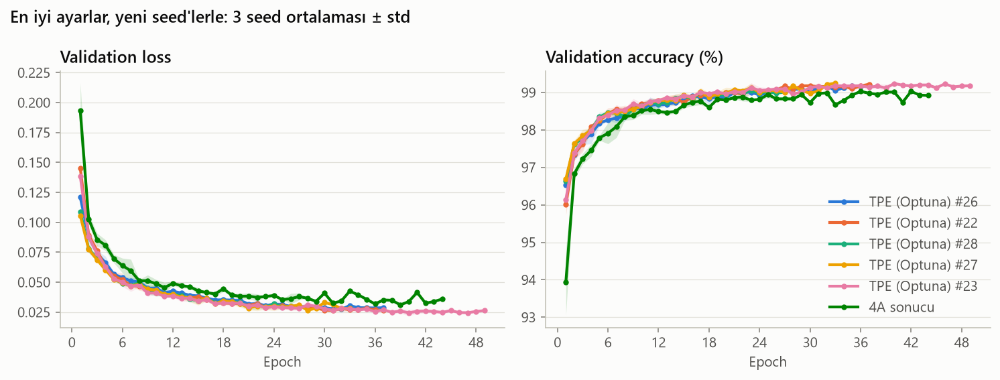

*Early stopping her seed'i farklı epoch'ta durdurduğu için eğitimler farklı uzunlukta; ortalama, o epoch'a ulaşan seed'ler üzerinden. Eğrilerin sonu bu yüzden daha az seed'e dayanıyor.*

- **Aramanın 5 ayarı birbirinden ayırt edilemiyor:** %99.00–99.18.
- **4A'nın sonucu %98.89; en iyiden 0.29 puan geride.** Eşik 0.3 olduğu için eşiğin içinde, ama tam sınırda.
- **4A'nın sonucu yavaş başlıyor:** 1. epoch'ta %93.93; aramanın ayarlarında %96.0–96.7. Batch normalization'ı yok ve batch'i büyük: epoch başına 98 güncelleme, batch 64'te 782.
- **Validation loss'ta fark daha belirgin:** Aramanın ayarlarında en düşük val loss 0.025–0.029, 4A'nın sonucunda 0.036. Eğriler bütün eğitim boyunca ayrı.
- **4A'nın sonucunun seed'leri daha dağınık** (%98.71–99.01). Seed 1'de eğitim 16. epoch'ta durdu (en iyi epoch 11); val loss'un epoch'tan epoch'a zikzakı, patience 5'i erken durdurmuş olabilir (Bölüm 5.8'in sınırlarından biri).
- **Maliyet:** Aramanın ayarları 7–11 kat daha fazla parametreye sahip ve ~11–14 kat daha uzun eğitiliyor (~38–50 sn'ye karşı ~3.6 sn).

**Karar:**
1. **Birincil ölçüt:** En iyi ayar TPE #23 (%99.18). Altı ayarın altısı da en iyiye 0.3 puandan yakın.
2. **En az parametreli:** 4A'nın sonucu (269 322 parametre).
3. **Seçilen: 4A'nın sonucu.** 2 gizli katman × 256 nöron, ReLU; momentumlu SGD (momentum 0.9), lr 0.08, batch 512; veri artırma (hafif); en fazla 100 epoch, early stopping (val loss, patience 5). Ayar [`results/arama/secilen_ayar.json`](results/arama/secilen_ayar.json) dosyasına yazıldı; Bölüm 7'deki final model bu dosyayı okuyor.
   - **Aramanın ayarları seçilmedi:** Doğrulukta eşiğin içindeler, ama 7–11 kat büyükler ve ~11–14 kat daha uzun eğitiliyorlar.

**Sınırda bir karar:**
- Fark (0.29 puan) eşiğe çok yakın ve ikincil göstergeler aramanın ayarlarından yana: validation loss'ları belirgin şekilde düşük, beşinin beşi de 4A'nın sonucunun üstünde, seed'leri daha kararlı. Bu yüzden ~0.2–0.3 puanlık farkın büyük ihtimalle gerçek olduğunu düşünüyoruz.
- Yine de kural sonuçlardan önce belirlendi ve sonuçları gördükten sonra değiştirilmedi. 0.3 puan, 10 000 test görüntüsünde ~30 görüntü demek; bunun için 7 kat büyük ve ~14 kat yavaş bir model seçmemek, kuralın amacına uygun.
- En yüksek doğruluk asıl hedef olsaydı, seçim TPE #23 olurdu (2 × 1024, momentumlu SGD, batch 64, batch normalization + dropout + weight decay + hafif veri artırma); beklenen kazanç ~0.3 puan.

**Ortak arama ne gösterdi?** Ayarların birlikte değiştirildiği çok daha geniş bir uzayda, 4A'nın tek tek bulduğu ayara göre en fazla ~0.3 puanlık bir kazanç bulunabildi. Etkileşimler var (büyük modeller ancak batch normalization ve dropout ile birlikte en üste çıkıyor; Bölüm 6.2), ama bu problemde kazançları küçük. Tek değişkenli yöntemin sınırı burada büyük bir kayba yol açmamış.

**Sınırlar:**
- 3 seed ile 0.1–0.2 puanlık farklar gürültü düzeyinde.
- Arama 60 denemeyle sınırlıydı; daha büyük bir bütçe daha iyi ayarlar bulabilirdi.
- Validation seti Bölüm 5 ve 6'da çok sayıda karar için kullanıldı; validation skorları bu yüzden biraz iyimser. Tarafsız tahmini test seti verecek (Bölüm 7).

## 7. Final Model ve Test Sonucu
_(Aşama 5'te doldurulacak)_

## 8. Kendi El Yazım ile Değerlendirme
_(Aşama 6'da doldurulacak)_

## 9. Genel Değerlendirme
_(Aşama 7'de doldurulacak)_
